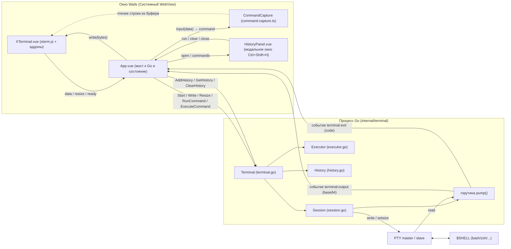
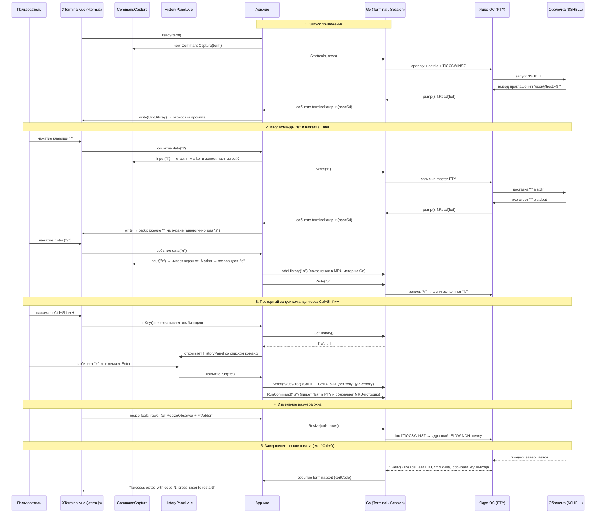

# Полное руководство по архитектуре и коду проекта Kutex

**Kutex** — это десктопный эмулятор терминала, построенный на фреймворке [Wails v3](https://v3.wails.io).
Бэкенд приложения написан на **Go (Golang 1.25)**, а пользовательский интерфейс — на **Vue 3 + TypeScript + UnoCSS** с использованием движка терминала **xterm.js** (включая аппаратное ускорение через WebGL).

Внутри приложения настоящая системная оболочка пользователя (`$SHELL` — например, `zsh` или `bash`) запускается внутри псевдотерминала (**PTY**). Благодаря этому полноценно работают интерактивные консольные программы (`vim`, `nvim`, `htop`, `less`, `tmux`), управляющие последовательности ANSI и 24-битный цвет (`truecolor`), сигналы прерывания (`Ctrl+C`), автодополнение по `Tab`, а также родная история команд оболочки. Поверх этого Kutex реализует собственный программный API для фонового выполнения команд и независимую от шелла встроенную систему истории команд с быстрым поиском по `Ctrl+Shift+H`.

---

## Содержание

1. [Высокоуровневая архитектура и структура проекта](#1-высокоуровневая-архитектура-и-структура-проекта)
2. [Подробный разбор Go-кода (Backend на Golang)](#2-подробный-разбор-go-кода-backend-на-golang)
   - [2.1. Конфигурация модуля (`go.mod`, `Taskfile.yml`, `build/config.yml`)](#21-конфигурация-модуля-gomod-taskfileyml-buildconfigyml)
   - [2.2. Точка входа приложения (`main.go`)](#22-точка-входа-приложения-maingo)
   - [2.3. Пакет `internal/terminal` — Ядро терминала](#23-пакет-internalterminal--ядро-терминала)
     - [`events.go` — Константы событий Wails](#eventsgo--константы-событий-wails)
     - [`terminal.go` — Главный фасад сервиса `Terminal`](#terminalgo--главный-фасад-сервиса-terminal)
     - [`session.go` — Интерактивная PTY-сессия (`Session`)](#sessiongo--интерактивная-pty-сессия-session)
     - [`executor.go` — Фоновое выполнение команд и отслеживание директории (`Executor`)](#executorgo--фоновое-выполнение-команд-и-отслеживание-директории-executor)
     - [`history.go` — Потокобезопасная MRU-история команд (`History`)](#historygo--потокобезопасная-mru-история-команд-history)
     - [Тесты пакета `internal/terminal` (`*_test.go`)](#тесты-пакета-internalterminal-_testgo)
   - [2.4. Пакет `internal/system` — Работа с файловой системой](#24-пакет-internalsystem--работа-с-файловой-системой)
     - [`system.go` — Сканирование директорий и симлинков](#systemgo--сканирование-директорий-и-симлинков)
     - [`system_test.go` — Модульные тесты `system`](#system_testgo--модульные-тесты-system)
   - [2.5. Пакет `internal/logger` — Структурированное логирование (`log/slog`)](#25-пакет-internallogger--структурированное-логирование-logslog)
     - [`logger.go` — Фасад логгера и управление конфигурацией](#loggergo--фасад-логгера-и-управление-конфигурацией)
     - [`handler.go` — Кастомный `slog.Handler` для консоли и файла](#handlergo--кастомный-sloghandler-для-консоли-и-файла)
     - [`wails.go` — Адаптер логгера для Wails v3 (`NewWailsAdapter`)](#wailsgo--адаптер-логгера-для-wails-v3-newwailsadapter)
     - [`logger_test.go` — Модульные тесты `logger`](#logger_testgo--модульные-тесты-logger)
3. [Подробный разбор Frontend-скриптов (Vue 3 + TypeScript)](#3-подробный-разбор-frontend-скриптов-vue-3--typescript)
   - [3.1. Конфигурация и точка входа фронтенда (`index.html`, `main.ts`, `style.css`, `uno.config.ts`, `vite.config.ts`)](#31-конфигурация-и-точка-входа-фронтенда)
   - [3.2. Автосгенерированные привязки Wails v3 (`frontend/bindings/`)](#32-автосгенерированные-привязки-wails-v3-frontendbindings)
   - [3.3. Утилита безопасных промисов (`frontend/src/shared/utils/index.ts`)](#33-утилита-безопасных-промисов-frontendsrcsharedutilsindexts)
   - [3.4. Поддержка иконок Nerd Font (`nerd-font.ts` и `nerd-font.css`)](#34-поддержка-иконок-nerd-font-nerd-fontts-и-nerd-fontcss)
   - [3.5. Захват введённых команд из экранного буфера (`command-capture.ts`)](#35-захват-введённых-команд-из-экранного-буфера-command-capturets)
   - [3.6. Компонент терминала (`XTerminal.vue`)](#36-компонент-терминала-xterminalvue)
   - [3.7. Модальная панель истории команд (`HistoryPanel.vue`)](#37-модальная-панель-истории-команд-historypanelvue)
   - [3.8. Корневой компонент-оркестратор (`App.vue`)](#38-корневой-компонент-оркестратор-appvue)
4. [Полный цикл взаимодействия: от нажатия клавиши до экрана](#4-полный-цикл-взаимодействия-от-нажатия-клавиши-до-экрана)
5. [Команды сборки, разработки и тестирования](#5-команды-сборки-разработки-и-тестирования)

---

## 1. Высокоуровневая архитектура и структура проекта



### Карта всех файлов проекта

```text
kutex/
├── main.go                                 # Точка входа Go: встраивание статики, инициализация Wails v3, окно и регистрация сервисов
├── go.mod / go.sum                         # Описание Go-модуля и дерево зависимостей (Wails v3, creack/pty, UserExistsError/conpty)
├── Taskfile.yml                            # Задачи сборки, разработки и упаковки Wails v3 (pnpm, dev, build, package)
├── build/config.yml                        # Конфигурация проекта и режима живой разработки wails3 dev
├── internal/                               # Приватные пакеты Go-бэкенда
│   ├── terminal/                           # Пакет управления терминалом
│   │   ├── events.go                       # Константы и регистрация событий Wails v3 ("terminal:output", "terminal:exit")
│   │   ├── terminal.go                     # Фасад сервиса Terminal, регистрируемый через application.NewService
│   │   ├── session.go                      # Общие типы и обработчики PTY-сессии (OutputHandler, ExitHandler)
│   │   ├── session_unix.go                 # Интерактивная PTY-сессия Unix/Linux/macOS на базе creack/pty
│   │   ├── session_windows.go              # Интерактивная PTY-сессия Windows 10/11 на базе ConPTY (UserExistsError/conpty)
│   │   ├── executor.go                     # Фоновое выполнение команд, перехват cd и отслеживание CWD
│   │   ├── executor_unix.go                # Реализация фонового шелла (-c) и живое чтение /proc/<pid>/cwd для Unix
│   │   ├── executor_windows.go             # Поддержка командных оболочек Windows (PowerShell, cmd.exe /c) и дисков
│   │   ├── history.go                      # Потокобезопасный MRU-буфер истории команд в памяти
│   │   ├── terminal_test.go                # Интеграционные тесты фасада Terminal
│   │   ├── session_test.go                 # Модульные тесты PTY-сессии
│   │   ├── executor_test.go                # Модульные тесты фонового исполнителя и навигации cd
│   │   └── history_test.go                 # Модульные тесты MRU-истории команд
│   ├── system/                             # Пакет работы с файловой системой ОС
│   │   ├── system.go                       # Поиск папок (включая симлинки на папки) и рекурсивный обход дерева
│   │   └── system_test.go                  # Тесты сканирования директорий и симлинков
│   └── logger/                             # Пакет структурированного логирования поверх log/slog
│       ├── logger.go                       # Фасад Logger, уровни, глобальный инстанс, тегирование компонентов
│       ├── handler.go                      # Кастомный slog.Handler: цветной ANSI-вывод в консоль и чистый текст в файл
│       ├── wails.go                        # Адаптер NewWailsAdapter (*slog.Logger с тегом "wails") для Wails v3
│       └── logger_test.go                  # Тесты форматирования, фильтрации уровней, записи в файл и адаптера Wails
└── frontend/                               # Фронтенд-приложение (Vue 3 + TypeScript + Vite + UnoCSS)
    ├── index.html                          # HTML-каркас приложения
    ├── package.json                        # Зависимости (@wailsio/runtime, xterm.js, Vue 3) и скрипты фронтенда
    ├── vite.config.ts                      # Конфигурация сборщика Vite (плагины Vue и UnoCSS, алиасы @ и api)
    ├── uno.config.ts                       # Конфигурация атомарного CSS-фреймворка UnoCSS (шрифты sans и mono)
    ├── eslint.config.mjs                   # Правила линтера (@antfu/eslint-config)
    ├── bindings/                           # Автоматически сгенерированные Wails v3 TS-привязки для сервисов и событий Go
    └── src/                                # Исходный код фронтенда
        ├── main.ts                         # Инициализация Vue-приложения и подключение стилей
        ├── style.css                       # Подключение локального шрифта Nunito
        ├── App.vue                         # Главный компонент: связь между XTerminal, HistoryPanel, CommandCapture и Go
        ├── components/
        │   ├── XTerminal.vue               # Обёртка над xterm.js (WebGL, FitAddon, WebLinksAddon, ResizeObserver)
        │   └── HistoryPanel.vue            # Всплывающее окно поиска и запуска команд из истории (Ctrl+Shift+H)
        ├── terminal/
        │   └── command-capture.ts          # Алгоритм чтения набранной команды из экранного буфера xterm при нажатии Enter
        ├── fonts/
        │   ├── nerd-font.css               # Объявление @font-face для Symbols Nerd Font Mono
        │   └── nerd-font.ts                # Предзагрузка шрифта иконок и внедрение фолбэка в font-family
        └── shared/utils/
            └── index.ts                    # Утилита safePromiseTyped для безопасной обработки промисов без try/catch
```

---

## 2. Подробный разбор Go-кода (Backend на Golang)

Весь бэкенд следует идиоматическому стилю Go и принципу единственной ответственности (**Single Responsibility Principle**). Код разделён на точку входа [`main.go`](file:///home/vlad/projects/kutex/main.go) и три изолированных пакета внутри директории `internal/`:
- `internal/terminal` — терминальная сессия, выполнение команд и история;
- `internal/system` — операции с файловой системой;
- `internal/logger` — структурированное логирование.

Разберём каждый файл, структуру и функцию подробно.

---

### 2.1. Конфигурация модуля (`go.mod`, `Taskfile.yml`, `build/config.yml`)

#### Файл [`go.mod`](file:///home/vlad/projects/kutex/go.mod)
Объявляет модуль `kutex` под версию **Go 1.25.0** и использует внешние зависимости:
1. **`github.com/creack/pty v1.1.24`** — стандартная де-факто библиотека в экосистеме Go для работы с псевдотерминалами (UNIX PTY на Linux и macOS). Она берёт на себя низкоуровневые системные вызовы `ioctl` для открытия пары master/slave файловых дескрипторов, создания новой сессии процесса (`setsid`), назначения управляющего терминала (`TIOCSCTTY`) и изменения размеров окна (`TIOCSWINSZ`).
2. **`github.com/UserExistsError/conpty v0.1.4`** — библиотека для работы с нативным Windows Pseudo Console (**ConPTY**) API на Windows 10 (версия 1809+) и Windows 11. Позволяет создавать и подключать псевдоконсоль Windows (`CreatePseudoConsole`), изменять её размер (`ResizePseudoConsole`) и запускать современные Windows-оболочки (PowerShell, `cmd.exe`) с полной поддержкой ANSI/VT escape-последовательностей.
3. **`github.com/wailsapp/wails/v3 v3.0.0`** — фреймворк нового поколения для создания кроссплатформенных десктопных приложений на Go и веб-технологиях (использует системный WebView: WebKitGTK 6.0 / GTK4 на Linux, WebKit на macOS, WebView2 на Windows и предоставляет быстрый двусторонний IPC-мост между TypeScript и Go).

#### Файлы [`Taskfile.yml`](file:///home/vlad/projects/kutex/Taskfile.yml) и [`build/config.yml`](file:///home/vlad/projects/kutex/build/config.yml)
Управляют процессом сборки, генерации привязок и разработки в Wails v3:
- `PACKAGE_MANAGER: '{{.PACKAGE_MANAGER | default "pnpm"}}'` — использование `pnpm` для установки пакетов и запуска скриптов во `frontend/`.
- `wails3 generate bindings -ts` — статический анализ Go-сервисов и генерация строго типизированных TypeScript-привязок во `frontend/bindings/`.
- `wails3 dev` — запуск режима живой разработки (Vite dev-сервер + автоматическая пересборка Go при изменениях).
- `wails3 build` — полная продакшен-сборка приложения в бинарный файл `bin/kutex`.
---

### 2.2. Точка входа приложения ([`main.go`](file:///home/vlad/projects/kutex/main.go))

Файл [`main.go`](file:///home/vlad/projects/kutex/main.go) отвечает за инициализацию всех сервисов и запуск нативного окна операционной системы.

```go
//go:embed all:frontend/dist
var assets embed.FS
```

1. **Встраивание статики (`//go:embed all:frontend/dist`):**
   Директива компилятора `//go:embed` упаковывает все скомпилированные файлы фронтенда из папки `frontend/dist` (`index.html`, JS-бандлы, CSS, шрифты `.woff2`) прямо внутрь исполняемого бинарного файла Go в переменную `assets` типа `embed.FS`. Благодаря этому готовое приложение распространяется как **один самодостаточный бинарник** без внешних файлов.

2. **Инициализация в функции [`main()`](file:///home/vlad/projects/kutex/main.go#L18-L45):**
   - `log := logger.Component("main")` — создаёт экземпляр структурированного логгера с меткой компонента `(main)` и выводит стартовое сообщение `Starting kutex...`.
   - `term := terminal.New()` — создаёт главный сервис управления терминалом.
   - `sys := system.New()` — создаёт сервис работы с файловой системой.

3. **Инициализация приложения `application.New(application.Options{...})`:**
   В Wails v3 создание приложения, создание окон и запуск цикла событий разделены на явные фазы:
   - `Name: "kutex"`, `Description: "Desktop terminal emulator built with Go and Wails"`, `Icon: appIcon` — метаданные и иконка приложения.
   - `Logger: logger.NewWailsAdapter(nil)` — передаёт стандартный `*slog.Logger` с тегом `(wails)`, чтобы внутренние системные сообщения фреймворка Wails v3 проходили через единый логгер приложения.
   - `Services: []application.Service{application.NewService(term), application.NewService(sys)}` — **сервисная архитектура Wails v3**. Регистрирует структуры `term` (`*terminal.Terminal`) и `sys` (`*system.System`) как сервисы приложения:
     1. Жизненный цикл сервиса автоматически связывается с методами `ServiceStartup(ctx, options)` и `ServiceShutdown()`.
     2. Генератор `wails3 generate bindings -ts` статически анализирует экспортируемые методы сервисов и создаёт TypeScript-модули `frontend/bindings/kutex/internal/terminal/terminal.ts` и `frontend/bindings/kutex/internal/system/system.ts`.
   - `Assets: application.AssetOptions{Handler: application.AssetFileServerFS(assets)}` — указывает встроенному серверу ассетов Wails v3 отдавать файлы из `embed.FS` в системный WebView.
   - `Linux: application.LinuxOptions{ProgramName: "kutex"}` и `Mac: application.MacOptions{ApplicationShouldTerminateAfterLastWindowClosed: true}`.

4. **Создание главного окна `app.Window.NewWithOptions(application.WebviewWindowOptions{...})` и запуск `app.Run()`:**
   - `Title: "kutex"`, `Width: 1024`, `Height: 768`, `URL: "/"` — заголовок, начальные размеры окна и стартовый маршрут.
   - `BackgroundColour: application.NewRGBA(27, 38, 54, 1)` — задаёт цвет фона нативного окна (`#1b2636`), в точности совпадающий с фоном терминала `xterm.js`, предотвращая белую вспышку при старте.
   - `Linux: application.LinuxWindow{Icon: appIcon, WebviewGpuPolicy: application.WebviewGpuPolicyNever}` — иконка окна и политика WebView GPU на Linux.
   - `app.Run()` — запускает главный цикл событий ОС и блокируется до закрытия приложения.
---

### 2.3. Пакет `internal/terminal` — Ядро терминала

Пакет `internal/terminal` разделён на 5 исходных файлов и 4 файла тестов. Каждый файл решает строго одну задачу.

---

#### 1. [`internal/terminal/events.go`](file:///home/vlad/projects/kutex/internal/terminal/events.go) — Константы событий Wails

В этом файле объявлены строковые константы имён событий, которые Go-бэкенд отправляет во фронтенд через шину событий Wails v3 (`app.Event.Emit`), а функция `init()` регистрирует их типы данных через `application.RegisterEvent`:

- **`EventTerminalOutput = "terminal:output"`** (`string`) — событие, несущее порцию (чанк) сырых байтов вывода из PTY, закодированную в строку **Base64**.
- **`EventTerminalExit = "terminal:exit"`** (`int`) — событие, уведомляющее фронтенд о том, что процесс оболочки завершился, и передающее целочисленный код возврата (`exitCode`).

Благодаря вызову `application.RegisterEvent[string](EventTerminalOutput)` и `application.RegisterEvent[int](EventTerminalExit)` генератор `wails3 generate bindings -ts` автоматически создаёт типизированные декларации событий `CustomEvents` для `@wailsio/runtime`.

---

#### 2. [`internal/terminal/terminal.go`](file:///home/vlad/projects/kutex/internal/terminal/terminal.go) — Главный фасад сервиса `Terminal`

Структура [`Terminal`](file:///home/vlad/projects/kutex/internal/terminal/terminal.go#L14-L19) — это сервис Wails v3, который связывает воедино три внутренних компонента (`Session`, `Executor`, `History`) и логгер без жёсткой привязки к `context.Context`:

```go
type Terminal struct {
	session  *Session        // Управляет интерактивным процессом шелла и PTY
	executor *Executor       // Выполняет одиночные фоновые команды и отслеживает текущую папку (CWD)
	history  *History        // Хранит историю выполненных команд в памяти (MRU)
	log      *logger.Logger  // Логгер с компонентным тегом (terminal)
}
```

Разберём все методы [`Terminal`](file:///home/vlad/projects/kutex/internal/terminal/terminal.go):

- **[`New() *Terminal`](file:///home/vlad/projects/kutex/internal/terminal/terminal.go#L22-L29):**
  Конструктор сервиса. Инициализирует `NewSession()`, `NewExecutor()`, `NewHistory(DefaultHistorySize)` (на 1000 команд) и логгер `logger.Component("terminal")`.

- **[`ServiceStartup(_ context.Context, _ application.ServiceOptions) error`](file:///home/vlad/projects/kutex/internal/terminal/terminal.go#L32-L35):**
  Хук жизненного цикла сервиса Wails v3, вызываемый при старте приложения. Пишет лог `Terminal service initialized`.

- **[`ServiceShutdown() error`](file:///home/vlad/projects/kutex/internal/terminal/terminal.go#L38-L42):**
  Хук жизненного цикла сервиса Wails v3, вызываемый при завершении приложения. Логирует остановку и вызывает `t.Stop()`, гарантируя чистое закрытие PTY и процесса оболочки.

- **[`Start(cols, rows int) error`](file:///home/vlad/projects/kutex/internal/terminal/terminal.go#L45-L67):**
  Запускает интерактивную оболочку пользователя с заданным числом колонок (`cols`) и строк (`rows`).
  1. Определяет стартовую рабочую директорию вызовом `cwd := t.GetCwd()`.
  2. Создаёт замыкание `onOutput := func(b64 string)`, которое при наличии активного экземпляра приложения (`if app := application.Get(); app != nil`) отправляет событие `app.Event.Emit(EventTerminalOutput, b64)` во фронтенд.
  3. Создаёт замыкание `onExit := func(code int)`, которое логирует код завершения процесса и отправляет событие `app.Event.Emit(EventTerminalExit, code)`.
  4. Передаёт управление в `t.session.Start(cols, rows, cwd, onOutput, onExit)`. Благодаря такой передаче колбэков сам объект `Session` ничего не знает про Wails и легко тестируется в изоляции.
- **[`Write(data string) error`](file:///home/vlad/projects/kutex/internal/terminal/terminal.go#L70-L72):**
  Принимает строку ввода от пользователя (нажатые клавиши, управляющие коды, вставленный текст) и напрямую передаёт её в `t.session.Write(data)` для записи в master-дескриптор PTY.

- **[`Resize(cols, rows int) error`](file:///home/vlad/projects/kutex/internal/terminal/terminal.go#L75-L78):**
  Логирует новые размеры сетки терминала на уровне `DEBUG` и вызывает `t.session.Resize(cols, rows)` для уведомления ядра ОС об изменении геометрии окна.

- **[`Stop()`](file:///home/vlad/projects/kutex/internal/terminal/terminal.go#L81-L84):**
  Логирует остановку сессии и вызывает `t.session.Stop()`.

- **[`RunCommand(command string) error`](file:///home/vlad/projects/kutex/internal/terminal/terminal.go#L87-L99):**
  Программно «впечатывает» и запускает команду прямо внутри активного интерактивного терминала (используется, например, при выборе команды из окна истории `Ctrl+Shift+H` или через `window.kutex.runCommand`):
  1. Проверяет `if !t.session.IsRunning()`. Если интерактивный шелл сейчас не запущен, пишет предупреждение в лог и возвращает ошибку `errNotRunning` (при этом команда **не** попадает в историю).
  2. Очищает строку от возможных символов перевода строки справа (`strings.TrimRight(command, "\r\n")`) и добавляет символ возврата каретки `"\r"` (эквивалент нажатия клавиши `Enter` в терминале).
  3. Отправляет получившуюся строку в PTY через `t.session.Write(cmd)`.
  4. Если запись прошла успешно, сохраняет исходную команду в историю `t.history.Add(command)` (что также перемещает её на первое место в списке недавних команд).

- **[`AddHistory(command string)`](file:///home/vlad/projects/kutex/internal/terminal/terminal.go#L103-L107):**
  Вызывается фронтендом каждый раз, когда пользователь нажимает `Enter` при обычном вводе в терминале. Делегирует сохранение в `t.history.Add(command)` и, если команда не была пустой, логирует запись на уровне `DEBUG`.

- **[`GetHistory() []string`](file:///home/vlad/projects/kutex/internal/terminal/terminal.go#L110-L112):**
  Возвращает срез всех сохранённых в истории команд (от самых свежих к самым старым) через `t.history.List()`.

- **[`ClearHistory()`](file:///home/vlad/projects/kutex/internal/terminal/terminal.go#L115-L118):**
  Очищает историю команд через `t.history.Clear()`.

- **[`ExecuteCommand(command string) (string, error)`](file:///home/vlad/projects/kutex/internal/terminal/terminal.go#L122-L129):**
  Выполняет команду в фоновом неинтерактивном режиме через `t.executor.Execute(command, t.session.Pid())`, передавая PID активной интерактивной сессии (чтобы фоновая команда знала текущую папку шелла), и возвращает объединённый вывод `stdout + stderr`.

- **[`GetCwd() string`](file:///home/vlad/projects/kutex/internal/terminal/terminal.go#L132-L134):**
  Возвращает текущую рабочую директорию терминала через `t.executor.GetCwd(t.session.Pid())`.

---

#### 3. [`internal/terminal/session.go`](file:///home/vlad/projects/kutex/internal/terminal/session.go), [`session_unix.go`](file:///home/vlad/projects/kutex/internal/terminal/session_unix.go) и [`session_windows.go`](file:///home/vlad/projects/kutex/internal/terminal/session_windows.go) — Интерактивная PTY-сессия (`Session`)

Модуль сессии отвечает за низкоуровневую работу с псевдотерминалом и дочерним процессом оболочки ОС. Для полной поддержки как POSIX-систем (Linux, macOS, WSL), так и нативной Windows 10/11 реализация разделена с помощью тегов компиляции:
- [`session.go`](file:///home/vlad/projects/kutex/internal/terminal/session.go) содержит общие типы колбэков (`OutputHandler`, `ExitHandler`) и ошибку `errNotRunning`.
- [`session_unix.go`](file:///home/vlad/projects/kutex/internal/terminal/session_unix.go) (`//go:build !windows`) — использует POSIX PTY через библиотеку `github.com/creack/pty`.
- [`session_windows.go`](file:///home/vlad/projects/kutex/internal/terminal/session_windows.go) (`//go:build windows`) — использует нативный Windows Pseudo Console (**ConPTY**) API через библиотеку `github.com/UserExistsError/conpty`.

```go
// Общие типы в session.go
var errNotRunning = errors.New("terminal: shell is not running")

type OutputHandler func(base64Data string)
type ExitHandler func(exitCode int)
```

##### 1. Реализация на Unix/Linux/macOS (`session_unix.go`)
В Unix-системах структура `Session` содержит `cmd *exec.Cmd` и `pty *os.File`:
- **Выделение PTY:** через `pty.StartWithSize(cmd, winsize(cols, rows))` открывается пара `/dev/ptmx` (master) и `/dev/pts/N` (slave).
- **Размер и сигналы:** вызов `pty.Setsize(f, winsize(cols, rows))` отправляет ядру команду `TIOCSWINSZ`, и ядро автоматически посылает `SIGWINCH` активному процессу.
- **Оболочка по умолчанию:** функция `defaultShell()` проверяет `$SHELL`, затем `/bin/bash`, `/bin/zsh`, `/bin/sh` и `"sh"`.

##### 2. Реализация на Windows 10/11 (`session_windows.go`)
В Windows нет `/dev/ptmx`. Начиная с Windows 10 (версия 1809) Microsoft добавила в `kernel32.dll` нативный механизм **ConPTY**:
- **Структура `Session`:** хранит дескриптор `cpty *conpty.ConPty`, контекст отмены `ctx context.Context` и функцию `cancel context.CancelFunc`.
- **Запуск псевдоконсоли:** вызов `conpty.Start(shell, conpty.ConPtyDimensions(cols, rows), conpty.ConPtyWorkDir(dir), conpty.ConPtyEnv(env))` создаёт пару анонимных каналов (pipes), инициализирует `_HPCON` через Win32 API `CreatePseudoConsole`, настраивает атрибуты потока `_PROC_THREAD_ATTRIBUTE_PSEUDOCONSOLE` и запускает процесс оболочки через Win32 `CreateProcess`.
- **Изменение размера:** метод `cpty.Resize(cols, rows)` вызывает Win32 API `ResizePseudoConsole`.
- **Оболочка по умолчанию на Windows:**
  1. Если задана переменная `$SHELL` (например, путь к Git Bash или Cygwin), проверяется её доступность через `exec.LookPath(sh)`.
  2. Если в системе установлен современный PowerShell 7+ (`pwsh.exe`), запускается он.
  3. Иначе запускается стандартный Windows PowerShell (`powershell.exe`), встроенный во все редакции Windows 10 и 11.
  4. В качестве резервной оболочки используется `%COMSPEC%` (`cmd.exe`).
- **Завершение и очистка:** при остановке `cpty.Close()` вызывает `ClosePseudoConsole`, освобождает системные дескрипторы и корректно завершает дочерний процесс.

##### Цикл чтения вывода: `pump()`
В обеих платформах горутина `pump()` считывает порции данных в буфер 32 КБ:
- На Unix читает из дескриптора `f.Read(buf)`.
- На Windows читает из пайпа вывода `cpty.Read(buf)`.
- Данные кодируются в Base64 (`base64.StdEncoding.EncodeToString`) для предотвращения разрыва многобайтовых символов UTF-8 при передаче через JSON-мост Wails.
- При завершении процесса считывается и отправляется код завершения (`onExit(code)`). Spurious-события выхода при принудительном `Stop()` блокируются обнулением дескриптора под мьютексом.

##### Остальные методы и вспомогательные функции `session.go`:
- **[`Write(data string) error`](file:///home/vlad/projects/kutex/internal/terminal/session.go#L58-L65):**
  Получает текущий файл PTY через потокобезопасный `s.currentPty()`. Если он `nil`, возвращает `errNotRunning`. Иначе записывает байты `[]byte(data)` в ведущий дескриптор PTY. Драйвер терминала в ядре ОС обрабатывает эти байты согласно настройкам `termios` (например, превращает байт `\x03` от `Ctrl+C` в сигнал `SIGINT` для активной группы процессов) и передаёт их в `stdin` программы.
- **[`Resize(cols, rows int) error`](file:///home/vlad/projects/kutex/internal/terminal/session.go#L68-L74):**
  Если сессия запущена, вызывает `pty.Setsize(f, winsize(cols, rows))`. Ядро ОС обновляет размеры терминала и автоматически посылает сигнал `SIGWINCH` (Window Change) дочернему процессу, благодаря чему `vim`, `htop` или `zsh` мгновенно перестраивают интерфейс под новый размер окна.
- **[`Pid() int`](file:///home/vlad/projects/kutex/internal/terminal/session.go#L77-L84):**
  Под мьютексом `s.mu` возвращает PID запущенного процесса оболочки (`s.cmd.Process.Pid`) или `0`, если процесс не запущен.
- **[`IsRunning() bool`](file:///home/vlad/projects/kutex/internal/terminal/session.go#L87-L89):**
  Проверяет `s.currentPty() != nil`.
- **[`Stop()`](file:///home/vlad/projects/kutex/internal/terminal/session.go#L92-L105):**
  Захватывает мьютекс `s.mu`, копирует ссылки `cmd, f := s.cmd, s.pty` в локальные переменные и сразу обнуляет поля структуры `s.cmd, s.pty = nil, nil` до разблокировки мьютекса. После этого вызывает `cmd.Process.Kill()` и `f.Close()`. Закрытие master-дескриптора `f.Close()` посылает сигнал `SIGHUP` всем дочерним процессам шелла и разблокирует висящий вызов `f.Read(buf)` в горутине `pump()`.
- **[`defaultShell() string`](file:///home/vlad/projects/kutex/internal/terminal/session.go#L142-L152):**
  Сначала проверяет переменную окружения `os.Getenv("SHELL")`. Если она пуста, последовательно проверяет наличие файлов `/bin/bash`, `/bin/zsh`, `/bin/sh` через `os.Stat`, а в крайнем случае возвращает `"sh"`.
- **[`winsize(cols, rows int) *pty.Winsize`](file:///home/vlad/projects/kutex/internal/terminal/session.go#L154-L162):**
  Защищает от некорректных (нулевых или отрицательных) размеров, подставляя стандартные `80x24`, и возвращает структуру `&pty.Winsize{Cols: uint16(cols), Rows: uint16(rows)}`.

---

#### 4. [`internal/terminal/executor.go`](file:///home/vlad/projects/kutex/internal/terminal/executor.go) — Фоновое выполнение команд и отслеживание директории (`Executor`)

Структура [`Executor`](file:///home/vlad/projects/kutex/internal/terminal/executor.go#L15-L19) предназначена для выполнения одиночных команд в фоне (без отображения в интерактивном терминале) и для отслеживания текущей рабочей директории (`CWD`):

```go
type Executor struct {
	mu         sync.Mutex
	currentDir string // Текущая отслеживаемая директория для фоновых команд
	prevDir    string // Предыдущая директория (для поддержки команды `cd -`)
}
```

Разберём все методы `executor.go`:

- **[`NewExecutor() *Executor`](file:///home/vlad/projects/kutex/internal/terminal/executor.go#L22-L28):**
  Создаёт экземпляр `Executor` и инициализирует `e.currentDir` домашней директорией пользователя (`os.UserHomeDir()`).

- **[`GetCwd(activePid int) string`](file:///home/vlad/projects/kutex/internal/terminal/executor.go#L32-L50):**
  Определяет актуальную рабочую директорию:
  1. **Живое чтение через `procCwd(activePid)`:** На Linux ядро поддерживает виртуальную символическую ссылку `/proc/<pid>/cwd`, указывающую в реальном времени на текущую папку запущенного процесса. Если пользователь ввёл `cd /var/log` в интерактивном терминале, вызов `GetCwd` мгновенно вернёт `"/var/log"`. На Windows (где инспекция CWD внешнего процесса требует сложного чтения недокументированных структур PEB в чужой памяти) используется сохранённое значение рабочего каталога `e.currentDir`.
  2. **Цепочка резервных значений (Fallback):** Если активный процесс не вернул путь, метод возвращает сохранённое поле `e.currentDir` (защищённое мьютексом `e.mu`). Если и оно пустое — возвращает `os.UserHomeDir()`, а в качестве системного корня (`defaultRootDir()`) — `"/"` на Unix или `C:\` (системный диск `%SystemDrive%`) на Windows.

- **[`SetCwd(dir string)`](file:///home/vlad/projects/kutex/internal/terminal/executor.go#L53-L58):**
  Под мьютексом `e.mu` сохраняет старое значение `e.currentDir` в `e.prevDir` и записывает новый путь в `e.currentDir`.

- **[`Execute(command string, activePid int) (string, error)`](file:///home/vlad/projects/kutex/internal/terminal/executor.go#L62-L82):**
  Выполняет команду в контексте текущей рабочей директории:
  1. Убирает пробелы по краям (`strings.TrimSpace(command)`). Если строка пустая, сразу возвращает `"", nil`.
  2. Получает текущую директорию `cwd := e.GetCwd(activePid)`.
  3. **Перехват команды `cd` (`if isPureCd(trimmed)`):**
     Потому что `cd` — это встроенная команда оболочки (shell builtin), которая меняет рабочую директорию только того процесса, в котором вызвана. Чистые вызовы `cd` перехватываются и обрабатываются внутри Go методом `e.handleCd(trimmed, cwd)`.
  4. **Кроссплатформенный запуск команд (`buildShellCmd`):**
     - На Unix (Linux, macOS, WSL) создаётся подпроцесс `exec.Command(shell, "-c", command)`.
     - На Windows реализация автоматически распознаёт тип оболочки: для `cmd.exe` формируется `exec.Command(shell, "/c", command)`, для PowerShell (`powershell.exe` / `pwsh.exe`) — `exec.Command(shell, "-NoProfile", "-NonInteractive", "-Command", command)`, а для POSIX-шеллов (`bash.exe` из Git/MSYS2) — флаг `-c`.
     - Процессу выставляются `cmd.Dir = cwd` и переменные окружения `TERM=xterm-256color`, `COLORTERM=truecolor`. Метод `cmd.CombinedOutput()` ждёт завершения команды, собирает весь её вывод из `stdout` и `stderr` в один буфер и возвращает `string(out), err`.

- **[`isPureCd(cmd string) bool`](file:///home/vlad/projects/kutex/internal/terminal/executor.go#L84-L89):**
  Проверяет, является ли команда одиночным переходом `cd`: строка должна быть равна `"cd"` либо начинаться с `"cd "` или `"cd\t"`, и при этом **не должна** содержать операторов ветвления, пайпов, перенаправлений или подстановок (`|&;<>()$\``). Например, `cd /tmp` или `cd /d D:\project` — это чистый `cd` (обрабатывается в Go), а `cd /tmp && ls` — составная команда.

- **[`handleCd(cmd, cwd string) (string, error)`](file:///home/vlad/projects/kutex/internal/terminal/executor.go#L91-L136):**
  Полная эмуляция поведения шелловского `cd` средствами Go:
  1. Отрезает префикс `"cd"` (`strings.TrimSpace(cmd[2:])`).
  2. Поддерживает Windows-флаг смены диска `/d` (например, `cd /d D:\workspace`).
  3. Если аргумент заключён в парные кавычки (`"..."` или `'...'`), снимает их.
  4. Поддерживает `cd` или `cd ~` (переход в `os.UserHomeDir()`), `cd -` (возврат в `e.prevDir`), `~/path` и `~\path`, а также абсолютные пути с буквой диска (`D:\path`) и относительные пути.
     - `cd` (без аргументов) или `cd ~` → домашняя папка `os.UserHomeDir()`.
     - `cd -` → берёт предыдущую директорию `e.prevDir` (или оставляет `cwd`, если `prevDir` ещё пуст).
     - `cd ~/...` → заменяет префикс `~/` на домашнюю директорию через `filepath.Join(home, target[2:])`.
     - Абсолютный путь (`filepath.IsAbs(target)`) нормализуется через `filepath.Clean(target)`.
     - Относительный путь склеивается с текущей папкой: `filepath.Clean(filepath.Join(cwd, target))`.
  4. Проверяет существование пути на диске через `os.Stat(targetDir)`. Если путь не существует — возвращает ошибку `os.Stat`. Если это обычный файл, а не папка (`!info.IsDir()`) — возвращает ошибку `cd: not a directory: <path>`.
  5. Вызывает `e.SetCwd(targetDir)` и записывает информационный лог через `logger.Component("executor")`.

---

#### 5. [`internal/terminal/history.go`](file:///home/vlad/projects/kutex/internal/terminal/history.go) — Потокобезопасная MRU-история команд (`History`)

Структура [`History`](file:///home/vlad/projects/kutex/internal/terminal/history.go#L16-L20) реализует собственное хранилище истории команд Kutex по принципу **MRU (Most-Recently-Used — недавно использованные первыми)** с фиксированным лимитом памяти:

```go
const DefaultHistorySize = 1000

type History struct {
	mu      sync.Mutex
	max     int      // Максимальное количество хранимых команд (по умолчанию 1000)
	entries []string // Внутренний срез: старые команды в начале, самые новые — в конце
}
```

Разберём методы `history.go`:

- **[`NewHistory(max int) *History`](file:///home/vlad/projects/kutex/internal/terminal/history.go#L24-L29):**
  Создаёт хранилище с лимитом `max`. Если передано `max <= 0`, используется `DefaultHistorySize` (`1000`).

- **[`Add(command string) bool`](file:///home/vlad/projects/kutex/internal/terminal/history.go#L33-L53):**
  Добавляет команду в историю и возвращает `true`, если команда была записана:
  1. Очищает строку от пробелов и переводов строк по краям (`strings.TrimSpace(command)`). Если строка пустая — возвращает `false`.
  2. Захватывает мьютекс `h.mu.Lock()`.
  3. **Дедупликация:** Проходит циклом по `h.entries`. Если такая команда уже есть в истории на позиции `i`, удаляет её со старого места (`h.entries = append(h.entries[:i], h.entries[i+1:]...)`) и прерывает цикл.
  4. Добавляет команду в самый конец среза (`h.entries = append(h.entries, command)`), делая её самой свежей.
  5. **Вытеснение старых записей без утечки памяти:**
     ```go
     if over := len(h.entries) - h.max; over > 0 {
         h.entries = append([]string(nil), h.entries[over:]...)
     }
     ```
     Обратите внимание на идиому `append([]string(nil), h.entries[over:]...)`: если бы мы просто написали `h.entries = h.entries[over:]`, срез продолжал бы ссылаться на всё более крупный старый базовый массив, а отрезанные в начале элементы не освобождались бы сборщиком мусора (GC). Копирование в новый срез `[]string(nil)` гарантирует, что размер базового массива никогда не превысит `h.max`.

- **[`List() []string`](file:///home/vlad/projects/kutex/internal/terminal/history.go#L56-L65):**
  Возвращает срез команд в обратном порядке (самая последняя выполненная команда — под индексом `0`):
  ```go
  out := make([]string, len(h.entries))
  for i, e := range h.entries {
      out[len(h.entries)-1-i] = e
  }
  return out
  ```
  Поскольку каждый раз выделяется новый срез `out`, вызывающий код получает **защитную копию (defensive copy)** — любые внешние изменения возвращённого среза не могут повредить внутреннее состояние `History`.

- **[`Clear()`](file:///home/vlad/projects/kutex/internal/terminal/history.go#L68-L72):**
  Под мьютексом сбрасывает `h.entries = nil`.

---

#### 6. Тесты пакета `internal/terminal` (`*_test.go`)

В пакете `internal/terminal` находятся 4 тестовых файла, покрывающих все компоненты:

1. **[`terminal_test.go`](file:///home/vlad/projects/kutex/internal/terminal/terminal_test.go):**
   - `TestTerminalService`: проверяет, что начальный `GetCwd()` равен домашней папке пользователя, что `ExecuteCommand("echo 'kutex service test'")` работает даже без запущенной интерактивной PTY-сессии, и что `RunCommand("ls")` на незапущенном терминале возвращает `errNotRunning`.
   - `TestTerminalHistory`: проверяет `AddHistory`, игнорирование пустых строк, порядок выдачи в `GetHistory()`, отсутствие записи в историю при неудачном вызове `RunCommand` и полную очистку через `ClearHistory()`.
2. **[`session_test.go`](file:///home/vlad/projects/kutex/internal/terminal/session_test.go):**
   - `TestSessionLifecycle`: запускает реальную PTY-сессию `s.Start(80, 24, ...)`, проверяет `s.IsRunning()` и `s.Pid() > 0`, отправляет команду `s.Write("echo HELLO_SESSION\r")`, меняет размер окна `s.Resize(100, 30)`, проверяет поступление Base64-вывода в колбэк `onOutput` и корректную остановку `s.Stop()`.
3. **[`executor_test.go`](file:///home/vlad/projects/kutex/internal/terminal/executor_test.go):**
   - `TestExecutor`: проверяет 10 сценариев работы `Executor`: начальный CWD, выполнение `pwd`, создание временной папки и переход в неё через `cd <tempDir>`, создание файла и проверку вывода `ls`, возврат назад через `cd -`, переход домой через `cd ~`, обработку кавычек `cd "<tempDir>"`, возврат ошибки при `cd` в несуществующую папку, возврат ошибки при `cd` в обычный файл и ошибку при запуске несуществующей команды.
4. **[`history_test.go`](file:///home/vlad/projects/kutex/internal/terminal/history_test.go):**
   - Проверяет добавление и тримминг пробелов (`TestHistoryAddAndList`), булев возврат `Add` (`TestHistoryAddReportsRecorded`), дедупликацию с переносом в начало (`TestHistoryDeduplicatesByMovingToFront`), вытеснение старых записей при превышении лимита `max` (`TestHistoryDropsOldestBeyondMax`), неизменяемость внутреннего состояния при мутации результата `List()` (`TestHistoryListReturnsCopy`) и очистку `Clear()` (`TestHistoryClear`).

---

### 2.4. Пакет `internal/system` — Работа с файловой системой

Пакет `internal/system` предоставляет методы для инспекции директорий ОС и зарегистрирован как сервис Wails v3 (`application.NewService(sys)`).

#### 1. [`internal/system/system.go`](file:///home/vlad/projects/kutex/internal/system/system.go) — Сканирование директорий и симлинков

- **Структура [`System`](file:///home/vlad/projects/kutex/internal/system/system.go#L12) и конструктор [`New()`](file:///home/vlad/projects/kutex/internal/system/system.go#L15-L17):**
  Пустая структура-сервис `type System struct{}`, методы которой (`GetFolders` и `GetFoldersRecursive`) экспортируются в Wails v3 и вызывают одноимённые функции пакета.

- **[`GetFolders(dirPath string) ([]string, error)`](file:///home/vlad/projects/kutex/internal/system/system.go#L34-L63):**
  Возвращает список имён всех поддиректорий первого уровня внутри `dirPath`:
  1. Если `dirPath == ""`, подставляется текущая директория `"."`.
  2. Вызывает `os.ReadDir(dirPath)`. В Go функция `os.ReadDir` читает записи каталога без лишних системных вызовов `stat` для каждого файла, но поэтому для символических ссылок `entry.IsDir()` возвращает `false`.
  3. Для каждой записи `entry`:
     - Если `entry.IsDir()` истинно — добавляет `entry.Name()` в список `folders`.
     - **Разрешение символических ссылок на папки:** Проверяет битовую маску режима файла `if entry.Type()&os.ModeSymlink != 0`. Если это симлинк, выполняет `os.Stat(filepath.Join(dirPath, entry.Name()))` (который следует по ссылке до конечной цели). Если цель существует и является директорией (`err == nil && info.IsDir()`), симлинк также включается в список папок (битые симлинки безопасно игнорируются).

- **[`GetFoldersRecursive(root string) ([]string, error)`](file:///home/vlad/projects/kutex/internal/system/system.go#L66-L89):**
  Рекурсивно обходит дерево каталогов начиная с `root` (или `"."`, если `root == ""`) с помощью быстрой стандартной функции `filepath.WalkDir`. Собирает пути всех вложенных поддиректорий (`d.IsDir() && path != root`) и возвращает их срез. Все операции и ошибки подробно логируются через `logger.Component("system")`.

#### 2. [`internal/system/system_test.go`](file:///home/vlad/projects/kutex/internal/system/system_test.go) — Модульные тесты `system`

- `TestGetFolders`: создаёт временную директорию с папками `alpha`, `beta`, текстовым файлом `test.txt` и символической ссылкой `symlink_alpha -> alpha`. Проверяет, что `GetFolders` возвращает папки и симлинк на папку, исключает обычный файл `test.txt`, одинаково работает через метод структуры `sys.GetFolders` и возвращает ошибку для несуществующего пути.
- `TestGetFoldersRecursive`: создаёт вложенное дерево `dir1/nested1` и `dir2` и проверяет, что `GetFoldersRecursive` находит ровно 3 поддиректории.

---

### 2.5. Пакет `internal/logger` — Структурированное логирование (`log/slog`)

Пакет `internal/logger` реализует собственную систему структурированного логирования без внешних зависимостей поверх стандартного пакета `log/slog` (введённого в Go 1.21+).

---

#### 1. [`internal/logger/logger.go`](file:///home/vlad/projects/kutex/internal/logger/logger.go) — Фасад логгера и управление конфигурацией

- **Уровни и конфигурация (`Level`, [`Config`](file:///home/vlad/projects/kutex/internal/logger/logger.go#L22-L27)):**
  Экспортирует уровни `LevelDebug`, `LevelInfo`, `LevelWarn`, `LevelError` (алиасы к `slog.Level`) и структуру настроек:
  ```go
  type Config struct {
      Level    slog.Level // Минимальный уровень логирования
      FilePath string     // Опциональный путь к файлу для дублирования логов
      UseColor bool       // Включить ли ANSI-цвета в консоли
      Output   io.Writer  // Поток вывода в консоль (по умолчанию os.Stderr)
  }
  ```
- **Автоматическое определение поддержки цветов ([`defaultUseColor()`](file:///home/vlad/projects/kutex/internal/logger/logger.go#L46-L51)):**
  Следует стандарту [no-color.org](https://no-color.org/): если задана переменная окружения `NO_COLOR != ""` или терминал имеет тип `TERM=dumb`, цвета автоматически отключаются.
- **Глобальный логгер по умолчанию (`init()`, `Init()`, `Default()`):**
  При загрузке пакета функция `init()` вызывает `initDefault()`, создавая потокобезопасный глобальный логгер, пишущий в `os.Stderr` с уровнем `LevelInfo`, и регистрирует его в стандартной библиотеке через `slog.SetDefault(...)`. Доступ к глобальному логгеру синхронизирован через `mu sync.RWMutex`. Метод `Init(cfg Config)` позволяет переконфигурировать глобальный логгер на лету (аккуратно закрывая предыдущий открытый лог-файл, если он был).
- **Создание логгера ([`New(cfg Config)`](file:///home/vlad/projects/kutex/internal/logger/logger.go#L63-L86)):**
  Если указан `cfg.FilePath`, открывает (или создаёт) файл с флагами `os.O_CREATE|os.O_WRONLY|os.O_APPEND` и правами `0644`. Создаёт `NewConsoleHandler(out, file, cfg.Level, cfg.UseColor)` и оборачивает его в `Logger`.
- **Контекстные методы [`With(args ...any)`](file:///home/vlad/projects/kutex/internal/logger/logger.go#L127-L133) и [`Component(name string)`](file:///home/vlad/projects/kutex/internal/logger/logger.go#L136-L138):**
  `Component("terminal")` вызывает `l.With("component", name)`, возвращая дочерний логгер, в котором к каждой записи автоматически прикрепляется атрибут `component=terminal`.

---

#### 2. [`internal/logger/handler.go`](file:///home/vlad/projects/kutex/internal/logger/handler.go) — Кастомный `slog.Handler` для консоли и файла

Структура [`ConsoleHandler`](file:///home/vlad/projects/kutex/internal/logger/handler.go#L23-L31) реализует стандартный интерфейс `slog.Handler` (методы `Enabled`, `Handle`, `WithAttrs`, `WithGroup`):

- **Извлечение компонента и атрибутов в [`Handle(_ context.Context, r slog.Record) error`](file:///home/vlad/projects/kutex/internal/logger/handler.go#L50-L127):**
  Проходит по предзаданным атрибутам хендлера (`h.attrs`) и атрибутам конкретной записи (`r.Attrs(...)`). Если ключ атрибута равен `"component"`, его значение сохраняется отдельно в переменную `component`, чтобы вывести его сразу после уровня лога в круглых скобках `(component)`, а остальные пары `ключ=значение` добавляются в конец строки.
- **Форматирование уровней ([`formatLevel`](file:///home/vlad/projects/kutex/internal/logger/handler.go#L159-L170)):**
  Выравнивает ширину всех уровней до 7 символов и назначает каждому свой ANSI-цвет:
  - `[DEBUG]` — голубой (`\033[36m`)
  - `[INFO] ` — зелёный (`\033[32m`)
  - `[WARN] ` — жёлтый (`\033[33m`)
  - `[ERROR]` — красный (`\033[31m`)
- **Двойной потокобезопасный вывод (Консоль + Файл):**
  Под защитой мьютекса `h.mu.Lock()` (чтобы строки от разных горутин никогда не перемешивались):
  1. **В консоль (`h.out`):** выводит краткое время с миллисекундами (`15:04:05.000`) в приглушённом стиле (`colorDim = "\033[2m"`), выделяет уровень жирным (`colorBold = "\033[1m"`) и цветом уровня (`levelColor`), окрашивает имя компонента `(component)` в пурпурный (`colorMagenta = "\033[35m"`), сам текст сообщения (`r.Message`) окрашивает в цвет соответствующего типа лога (`DEBUG` — голубой, `INFO` — зелёный, `WARN` — жёлтый, `ERROR` — красный), а ключи атрибутов приглушает (`colorDim`):
     ```text
     02:46:02.626 [INFO]  (main) Starting kutex...
     02:46:02.710 [INFO]  (terminal) Starting interactive terminal cols=110 rows=32 cwd=/home/vlad
     ```
  2. **В файл (`h.file`, если задан):** записывает строку с полной датой (`2006-01-02 15:04:05.000`) и **полностью без управляющих ANSI-кодов цвета**, чтобы лог-файл легко читался в любом текстовом редакторе или парсере.

---

#### 3. [`internal/logger/wails.go`](file:///home/vlad/projects/kutex/internal/logger/wails.go) — Адаптер логгера для Wails v3 (`NewWailsAdapter`)

Фреймворк Wails v3 принимает для своих внутренних системных логов стандартный `*slog.Logger` в поле `application.Options.Logger`.
Функция [`NewWailsAdapter(l *Logger) *slog.Logger`](file:///home/vlad/projects/kutex/internal/logger/wails.go#L8-L13) берёт наш `*Logger` (или `Default()`, если передан `nil`), создаёт дочерний логгер с тегом `.Component("wails")` и возвращает его базовый `*slog.Logger` через `.Slog()`.

---

#### 4. [`internal/logger/logger_test.go`](file:///home/vlad/projects/kutex/internal/logger/logger_test.go) — Модульные тесты `logger`

Проверяет все аспекты работы логгера:
- `TestConsoleHandlerFormatting`: точность форматирования всех 4 уровней (`[DEBUG]`, `[INFO] `, `[WARN] `, `[ERROR]`) и атрибутов `key=value`.
- `TestComponentTagging`: отображение тега `(terminal)` при вызове `l.Component("terminal")`.
- `TestLogLevelFiltering`: отсечение `Debug` и `Info` сообщений, когда установлен порог `LevelWarn`.
- `TestColorFormatting`: присутствие ANSI-последовательностей `\033[` при `UseColor: true`.
- `TestFileLogging`: проверка того, что при одновременной цветной записи в консоль и в файл сам файл на диске содержит чистый текст **без** ANSI-кодов `\033[`.
- `TestWailsAdapter`: проверка логирования через `*slog.Logger`, возвращаемый `NewWailsAdapter`, и наличия метки `(wails)` в каждой строке.
- `TestInitAndDefault`: проверка работы глобальных функций пакета (`Debug`, `Info`, `Warn`, `Error`).

---

## 3. Подробный разбор Frontend-скриптов (Vue 3 + TypeScript)

Фронтенд отвечает за рендеринг сетки терминала на GPU, загрузку шрифтов с иконками, чтение набранных команд с экрана при нажатии `Enter`, отображение модального окна истории по `Ctrl+Shift+H` и связь с Go-бэкендом.

---

### 3.1. Конфигурация и точка входа фронтенда

1. **[`frontend/index.html`](file:///home/vlad/projects/kutex/frontend/index.html):**
   Корневой HTML-документ. Задаёт базовый фон `bg-[#1b2636]`, белый текст, контейнер `<div id="app" class="h-screen text-center"></div>` и подключает точку входа `./src/main.ts`.
2. **[`frontend/src/main.ts`](file:///home/vlad/projects/kutex/frontend/src/main.ts):**
   Импортирует корневой компонент `App.vue`, глобальный файл шрифтов `style.css`, виртуальный модуль утилитарных классов UnoCSS (`import 'virtual:uno.css'`) и монтирует приложение `createApp(App).mount('#app')`.
3. **[`frontend/src/style.css`](file:///home/vlad/projects/kutex/frontend/src/style.css):**
   Регистрирует правило `@font-face` для локального шрифта интерфейса `Nunito` (`assets/fonts/nunito-v16-latin-regular.woff2`).
4. **[`frontend/uno.config.ts`](file:///home/vlad/projects/kutex/frontend/uno.config.ts):**
   Настраивает тему UnoCSS: определяет семейства шрифтов `font-sans` (с `Nunito` во главе) для UI-элементов (например, модального окна истории) и `font-mono` (`Menlo, Consolas, "DejaVu Sans Mono", "Liberation Mono", monospace`) для моноширинного текста.
5. **[`frontend/vite.config.ts`](file:///home/vlad/projects/kutex/frontend/vite.config.ts):**
   Подключает плагины `@vitejs/plugin-vue` и `unocss/vite`, а также настраивает путевые алиасы `'@'` → `./src` и `'api'` → `./bindings`.
6. **[`frontend/eslint.config.mjs`](file:///home/vlad/projects/kutex/frontend/eslint.config.mjs):**
   Настраивает единый стиль кода через `@antfu/eslint-config` (отступы в 2 пробела, одинарные кавычки, без точек с запятой, игнорирование автосгенерированной папки `bindings/**`).

---

### 3.2. Автосгенерированные привязки Wails v3 (`frontend/bindings/`)

Файлы в этой папке создаются автоматически командой `wails3 generate bindings -ts` на основе Go-сервисов, зарегистрированных через `application.NewService(...)`, и событий, зарегистрированных через `application.RegisterEvent(...)`:
- **[`frontend/bindings/kutex/internal/terminal/terminal.ts`](file:///home/vlad/projects/kutex/frontend/bindings/kutex/internal/terminal/terminal.ts):**
  Экспортирует типизированные функции `Start`, `Write`, `Resize`, `Stop`, `RunCommand`, `ExecuteCommand`, `GetCwd`, `AddHistory`, `GetHistory`, `ClearHistory`. Каждая из них вызывает `$Call.ByID(...)` из пакета `@wailsio/runtime` и возвращает `CancellablePromise`.
- **[`frontend/bindings/kutex/internal/system/system.ts`](file:///home/vlad/projects/kutex/frontend/bindings/kutex/internal/system/system.ts):**
  Экспортирует функции `GetFolders(dirPath)` и `GetFoldersRecursive(root)`.
- **`@wailsio/runtime` и [`frontend/src/shared/api/index.ts`](file:///home/vlad/projects/kutex/frontend/src/shared/api/index.ts):**
  Пакет `@wailsio/runtime` предоставляет клиентский API рантайма Wails v3, включая шину событий `Events.On(eventName, callback)`, где `callback` получает объект события `WailsEvent` (`{ name, data, sender }`). Модуль `frontend/src/shared/api/index.ts` централизованно реэкспортирует методы сервисов и оборачивает `Events.On` в функцию `EventsOn`, распаковывающую `event.data`.
---

### 3.3. Утилита безопасных промисов ([`frontend/src/shared/utils/index.ts`](file:///home/vlad/projects/kutex/frontend/src/shared/utils/index.ts))

Файл экспортирует обобщённую (generic) функцию [`safePromiseTyped`](file:///home/vlad/projects/kutex/frontend/src/shared/utils/index.ts#L1-L15):

```ts
export async function safePromiseTyped<
  T,
  E extends new (...args: never[]) => Error,
>(
  promise: Promise<T>,
  errorsToCatch?: E[],
): Promise<[undefined, T] | [InstanceType<E>]>
```

Она преобразует любой `Promise<T>` в кортеж в стиле Go (`[undefined, data]` при успехе или `[error]` при ошибке). Это позволяет в компонентах Vue (например, в `App.vue`) писать плоский и читаемый асинхронный код `const [err, data] = await safePromiseTyped(GetHistory())` без громоздких блоков `try { ... } catch { ... }`. Если передан необязательный список классов ошибок `errorsToCatch`, функция перехватывает только указанные типы ошибок, а остальные пробрасывает дальше (`throw error`).

---

### 3.4. Поддержка иконок Nerd Font ([`nerd-font.ts`](file:///home/vlad/projects/kutex/frontend/src/fonts/nerd-font.ts) и [`nerd-font.css`](file:///home/vlad/projects/kutex/frontend/src/fonts/nerd-font.css))

Современные темы командной строки (`starship`, `oh-my-posh`, `powerlevel10k`) и утилиты (`eza --icons`, `lsd`, `neovim`, `lazygit`) активно используют глифы из области личного использования Unicode (Private Use Area) для отображения стрелок Powerline, значков веток Git и иконок типов файлов.

Чтобы эти иконки работали в Kutex «из коробки» на любой системе без необходимости устанавливать пропатченные шрифты в ОС, реализована связка из двух файлов:

1. **[`frontend/src/fonts/nerd-font.css`](file:///home/vlad/projects/kutex/frontend/src/fonts/nerd-font.css):**
   Подключает встроенный в проект файл шрифта `SymbolsNerdFontMono-Regular.woff2` под именем `"Symbols Nerd Font Mono"` с правилом `font-display: block`. Этот шрифт содержит **только иконки** (без обычных букв и цифр), а его моноширинная (`Mono`) версия гарантирует, что каждая иконка занимает ровно 1 знакоместо терминала.
2. **[`frontend/src/fonts/nerd-font.ts`](file:///home/vlad/projects/kutex/frontend/src/fonts/nerd-font.ts):**
   - **[`withNerdFont(fontFamily: string): string`](file:///home/vlad/projects/kutex/frontend/src/fonts/nerd-font.ts#L56-L67):**
     Разбирает CSS-строку `font-family` по запятым и автоматически вставляет `"Symbols Nerd Font Mono"` **строго перед** первым общим ключевым словом (`monospace`, `ui-monospace`, `sans-serif`, `serif`, `system-ui`).
     *Почему это важно:* если поставить шрифт иконок после `monospace`, браузер при встрече неизвестного символа сначала обратится к системному `monospace`-шрифту ОС, не найдёт там иконку, нарисует пустой квадрат (`□`) и никогда не дойдёт до следующего элемента в списке. Постановка перед `monospace` гарантирует, что обычные буквы рисуются основным шрифтом пользователя, а отсутствующие в нём коды иконок берутся из `Symbols Nerd Font Mono`.
   - **[`loadNerdFont(): Promise<void>`](file:///home/vlad/projects/kutex/frontend/src/fonts/nerd-font.ts#L32-L44):**
     Браузеры лениво загружают веб-шрифты только тогда, когда символ из них появляется в DOM-дереве. Так как `xterm.js` рисует текст на `<canvas>` через WebGL, без принудительной предзагрузки первое приглашение шелла отрендерится до скачивания шрифта, и иконки закешируются в текстурном атласе WebGL как пустые квадратики. `loadNerdFont()` принудительно инициирует загрузку через `document.fonts.load('16px "Symbols Nerd Font Mono"', '\uE0B0')` (используя глиф стрелки Powerline `\uE0B0`), кеширует промис в переменной `loading` и никогда не завершается с reject.

---

### 3.5. Захват введённых команд из экранного буфера ([`frontend/src/terminal/command-capture.ts`](file:///home/vlad/projects/kutex/frontend/src/terminal/command-capture.ts))

Одной из самых интересных задач в эмуляторе терминала является получение точного текста команды, которую выполнил пользователь, чтобы сохранить её во встроенную историю Kutex.

#### Почему нельзя просто собирать нажатые клавиши в строку?
Потому что редактированием строки занимается сам шелл (`bash`/`zsh`) внутри PTY:
- Пользователь может набрать `git ch<Tab><Enter>`, и в событии ввода `onData` мы увидим только `"git ch\t\r"`, тогда как сам шелл развернул это на экране в `git checkout `.
- Пользователь может нажать стрелку `Up` (`\x1b[A`), вызвать команду пятиминутной давности, удалить слово через `Ctrl+W` (`\x17`) и нажать `Enter`.

#### Как работает класс [`CommandCapture`](file:///home/vlad/projects/kutex/frontend/src/terminal/command-capture.ts#L16-L75):
Вместо того чтобы пытаться угадать команду по нажатым клавишам, `CommandCapture` запоминает **координату на экране терминала**, где пользователь начал печатать команду после приглашения шелла (prompt), а в момент нажатия `Enter` (`\r`) считывает итоговый отредактированный текст прямо из активного экранного буфера `xterm.js`!

Пошаговый алгоритм метода **[`input(data: string): string | undefined`](file:///home/vlad/projects/kutex/frontend/src/terminal/command-capture.ts#L26-L52)**:
1. **Проверка альтернативного буфера (`buffer.type === 'alternate'`):**
   Полноэкранные программы (`vim`, `nvim`, `less`, `htop`, `man`) переключают терминал в альтернативный экранный буфер (`\x1b[?1049h`). Если активен `alternate` буфер, `CommandCapture` вызывает `this.reset()` и возвращает `undefined`. Благодаря этому нажатия `Enter` внутри `vim` или `less` никогда не засоряют историю команд шелла.
2. **Обработка нажатия `Enter` (`data === '\r'`):**
   Когда пользователь нажимает `Enter`, метод вызывает `this.read()` для чтения текста команды с экрана, сбрасывает маркер (`this.reset()`) и возвращает полученную строку (или `undefined`, если строка пустая).
3. **Сброс при прерывании (`Ctrl+C`) или многострочной вставке без Bracketed Paste:**
   - Если `data` содержит `\x03` (`Ctrl+C`), пользователь отменил ввод текущей строки — вызывается `this.reset()`.
   - Если `data` содержит `\r` внутри длинного чанка, но без маркера режима Bracketed Paste (`\x1B[200~`), значит в терминал разом отправлено несколько строк, которые ещё не успели поочерёдно отобразиться в буфере — состояние также сбрасывается.
4. **Установка начального маркера (`!this.start`):**
   При самом первом нажатии клавиши на новой строке приглашения сохраняется точка старта:
   ```ts
   this.start = { marker: this.term.registerMarker(0), col: buffer.cursorX }
   ```
   - `buffer.cursorX` — колонка курсора сразу после текста приглашения (например, сразу после `vlad@pc:~$ `).
   - `this.term.registerMarker(0)` — создаёт специальный объект `IMarker` в `xterm.js` на текущей строке курсора. В отличие от простого номера строки, `IMarker` автоматически смещает своё свойство `.line` вверх, если терминал прокручивается при достижении нижнего края экрана.
5. **Чтение команды из буфера ([`read(): string`](file:///home/vlad/projects/kutex/frontend/src/terminal/command-capture.ts#L61-L74)):**
   - Проверяет валидность маркера (`start && !start.marker.isDisposed && start.marker.line >= 0`).
   - Считывает текст первой строки начиная с колонки `start.col`: `buffer.getLine(row)?.translateToString(false, start.col) ?? ''`.
   - Если команда была длинной и перенеслась на следующие строки экрана, цикл `for (let line = buffer.getLine(++row); line?.isWrapped; ...)` проверяет флаг переноса `line.isWrapped` и доклеивает продолжение строки.
   - В конце обрезает пробелы по краям через `.trim()`.

---

### 3.6. Компонент терминала ([`frontend/src/components/XTerminal.vue`](file:///home/vlad/projects/kutex/frontend/src/components/XTerminal.vue))

[`XTerminal.vue`](file:///home/vlad/projects/kutex/frontend/src/components/XTerminal.vue) — переиспользуемый UI-компонент, инкапсулирующий работу с `@xterm/xterm` и его аддонами.

Что происходит внутри компонента:
1. **Ранняя загрузка шрифта иконок:** На уровне модуля сразу вызывается `loadNerdFont()`, чтобы скачивание `.woff2` началось ещё до монтирования DOM.
2. **Инициализация в `onMounted`:**
   - Формирует настройки `ITerminalOptions`: мигающий курсор (`cursorBlink: true`), процедурная отрисовка блочных символов и стрелок Powerline (`customGlyphs: true`), размер шрифта `14`, тема с фоном `#1b2636`.
   - Оборачивает `options.fontFamily` через `withNerdFont(...)`.
   - Создаёт `new Terminal(options)`, подключает `FitAddon` (расчёт числа колонок и строк по размеру DOM-контейнера) и `WebLinksAddon` (превращает ссылки в выводе терминала в кликабельные URL).
   - Монтирует терминал в `<div ref="container">` и включает аппаратный рендерер **WebGL** (`loadWebgl(t)`). Если WebGL недоступен или графический контекст потерян (`webgl.onContextLoss`), аддон аккуратно выгружается (`webgl.dispose()`), и `xterm.js` прозрачно переключается на стандартный DOM-рендерер.
   - Вызывает `fit()` для первичной подгонки размеров сетки.
3. **Перерисовка текстурного атласа после загрузки Nerd Font:**
   ```ts
   loadNerdFont().then(() => {
     if (term.value !== t) return
     t.clearTextureAtlas()
     t.refresh(0, t.rows - 1)
   })
   ```
   Если первый промпт шелла успел отрисоваться на несколько миллисекунд раньше, чем загрузился шрифт иконок, очистка текстурного атласа WebGL (`clearTextureAtlas()`) и принудительное обновление строк (`refresh`) мгновенно заменяют пустые квадратики на настоящие иконки.
4. **Автоматический ресайз (`ResizeObserver`):**
   Наблюдает за изменениями размеров контейнера `div` и внутри `requestAnimationFrame` вызывает `fit()`. Когда `fit()` меняет количество колонок или строк, `xterm` генерирует событие `onResize`, которое пробрасывается наверх (`emit('resize', size)`).
5. **Публичный интерфейс (`defineExpose`):**
   Предоставляет родительскому компоненту методы `write`, `writeln`, `clear`, `focus`, `fit` и ссылку `term`. При размонтировании (`onBeforeUnmount`) отключает `ResizeObserver` и освобождает ресурсы `term.value?.dispose()`.

---

### 3.7. Модальная панель истории команд ([`frontend/src/components/HistoryPanel.vue`](file:///home/vlad/projects/kutex/frontend/src/components/HistoryPanel.vue))

Компонент [`HistoryPanel.vue`](file:///home/vlad/projects/kutex/frontend/src/components/HistoryPanel.vue) отображает всплывающее окно истории команд при нажатии **`Ctrl+Shift+H`**.

- **Входные свойства (`props`) и события (`emit`):**
  Принимает массив `commands: string[]` (от новых к старым) и генерирует события `run(command: string)`, `clear()` и `close()`.
- **Мгновенный поиск (`filtered`):**
  Вычисляемое свойство `filtered` приводит поисковый запрос `filter.value` к нижнему регистру и фильтрует массив `props.commands` по вхождению подстроки (`c.toLowerCase().includes(needle)`). Наблюдатель `watch(filtered, () => (selected.value = 0))` сбрасывает выделение на первый элемент при каждом изменении текста поиска.
- **Удобное управление с клавиатуры и мыши:**
  - При открытии (`onMounted`) фокус ввода сразу устанавливается в поисковое поле `filterInput.value?.focus()`.
  - Нажатия клавиш в поле поиска перехватываются через `@keydown.prevent="onKeydown"` и обрабатываются словарём `keydownCommands`:
    - `ArrowDown` / `ArrowUp`: функция `move(delta)` циклически сдвигает индекс выбранной команды по модулю `(selected.value + delta + count) % count` (с нижней строки перескакивает на верхнюю и наоборот) и в `nextTick` вызывает `scrollIntoView({ block: 'nearest' })`, чтобы выделенный элемент всегда оставался в видимой области списка.
    - `Enter`: вызывает `run()`, отправляя событие `emit('run', command)` с выбранной командой.
    - `Escape` (а также клик мышью по затемнённому фону `@mousedown.self="emit('close')"`): закрывает модальное окно.
  - Наведение мыши (`@mousemove="selected = i"`) подсвечивает строку, а клик (`@click="run(i)"`) сразу запускает команду.
  - Кнопка **Clear history** в нижней панели вызывает `emit('clear')` и автоматически блокируется (`:disabled="!commands.length"`), если история пуста.

---

### 3.8. Корневой компонент-оркестратор ([`frontend/src/App.vue`](file:///home/vlad/projects/kutex/frontend/src/App.vue))

[`App.vue`](file:///home/vlad/projects/kutex/frontend/src/App.vue) (и [`TerminalPage.vue`](file:///home/vlad/projects/kutex/frontend/src/pages/terminal/ui/TerminalPage.vue)) связывает все части фронтенда с Go-методами из `frontend/bindings/kutex/internal/terminal/terminal`:

1. **Глобальный API `window.kutex` (строки 12–20):**
   Экспортирует в глобальный объект `window.kutex` методы `executeCommand`, `runCommand`, `getCwd`, `getHistory` и `clearHistory`, позволяя вызывать Go-бэкенд напрямую из консоли разработчика (`F12`) или внешних скриптов автоматизации.
2. **Подписка на события Go на этапе `setup` (строки 51–59):**
   Подписывается на события Wails **до** того, как дочерний `XTerminal.vue` смонтируется и запустит шелл (благодаря этому самый первый вывод приглашения командной строки никогда не теряется):
   - При получении `terminal:output` декодирует строку Base64 в `Uint8Array` функцией `decodeBase64` (`Uint8Array.from(atob(b64), c => c.charCodeAt(0))`) и передаёт сырые байты в `terminal.value?.write(...)`.
   - При получении `terminal:exit` ставит флаг `exited = true` и печатает в терминале приглушённым шрифтом сообщение: `[process exited with code ${code}, press Enter to restart]`.
3. **Инициализация терминала и перехват `Ctrl+Shift+H` (`onReady` и `onKey`, строки 61–77):**
   Когда `XTerminal` сообщает о готовности (`@ready="onReady"`):
   - Создаётся экземпляр `capture = new CommandCapture(term)`.
   - Регистрируется перехватчик клавиш `term.attachCustomKeyEventHandler(onKey)`. Если нажата комбинация **`Ctrl+Shift+H`** (`e.ctrlKey && e.shiftKey && !e.altKey && !e.metaKey && e.code === 'KeyH'`), `onKey` отменяет стандартное действие браузера, вызывает `openHistory()` и возвращает `false`, чтобы `xterm.js` не отправлял эти нажатия в PTY.
   - Вызывается `startShell(term.cols, term.rows)`, который запускает Go-метод `Start(cols, rows)`.
4. **Обработка пользовательского ввода (`onData`, строки 88–102):**
   - **Если шелл работает (`!exited`):**
     1. Сначала передаёт введённые данные в `const command = capture?.input(data)` (важно сделать это **до** отправки `\r` в PTY, пока строка команды и курсор ещё находятся на месте в буфере экрана).
     2. Если `capture.input(data)` вернул строку команды (пользователь нажал `Enter`), асинхронно сохраняет её в Go через `AddHistory(command)`.
     3. Пересылает нажатие клавиши в PTY через `Write(data)`.
   - **Если шелл завершился (`exited === true`):**
     Игнорирует любые клавиши, кроме `Enter` (`\r`). При нажатии `Enter` очищает экран (`terminal.value?.clear()`) и заново запускает оболочку (`startShell`).
5. **Повторный запуск команды из панели истории (`runFromHistory`, строки 125–134):**
   Когда пользователь выбирает команду в `HistoryPanel.vue`:
   - Закрывает модальное окно и возвращает фокус ввода в терминал (`closeHistory()`).
   - Сбрасывает состояние `capture?.reset()`.
   - Параллельно выполняет `Promise.all([Write(CLEAR_LINE), RunCommand(command)])`:
     - Сначала отправляет в PTY последовательность `CLEAR_LINE = '\x05\x15'`: байт `\x05` (`Ctrl+E`) перемещает курсор в самый конец текущей строки ввода, а байт `\x15` (`Ctrl+U`) удаляет весь набранный текст от конца строки до приглашения шелла в `bash`/`zsh`. Это гарантирует, что если пользователь начал что-то печатать, а затем нажал `Ctrl+Shift+H`, выбранная из истории команда не приклеится к недопечатанному тексту, а чисто заменит его.
     - Затем `RunCommand(command)` на стороне Go записывает `command + "\r"` в PTY и перемещает эту команду наверх MRU-истории.

---

## 4. Полный цикл взаимодействия: от нажатия клавиши до экрана

Ниже представлена диаграмма последовательности, иллюстрирующая все 5 ключевых сценариев работы приложения:



> [!NOTE]
> **Почему при вводе паролей (`sudo`, `ssh`) символы не отображаются на экране?**
> Как видно на диаграмме выше, `XTerminal.vue` никогда не рисует нажатые пользователем буквы самостоятельно. Он лишь отправляет коды клавиш в Go (`Write`), который передаёт их в PTY. Буква появляется на экране только тогда, когда драйвер PTY или сама оболочка возвращает её обратно («эхо»). Когда `sudo` или `ssh` запрашивают пароль, они временно отключают флаг `ECHO` в настройках терминала (`termios`), поэтому ядро ОС перестаёт возвращать эхо-символы в `pump()`, и ввод пароля остаётся скрытым автоматически.

---

## 5. Команды сборки, разработки и тестирования

| Команда | Описание |
|---|---|
| `wails3 dev` | Запускает режим живой разработки (по конфигурации `build/config.yml`): поднимает Vite dev-сервер с мгновенным HMR, компилирует Go-код в dev-режиме и открывает нативное окно приложения |
| `wails3 build` | Запускает пайплайн `Taskfile.yml`: обновляет иконки и `.desktop`, устанавливает зависимости фронтенда (`pnpm install`), генерирует TS-привязки (`wails3 generate bindings -ts`), собирает `frontend/dist` и компилирует единый исполняемый файл в `bin/kutex` |
| `wails3 generate bindings -ts` | Перегенерирует TypeScript-привязки в `frontend/bindings/` по зарегистрированным Go-сервисам и событиям без запуска окна |
| `go test -v ./...` | Запускает все модульные и интеграционные тесты Go (`internal/terminal`, `internal/system`, `internal/logger`) |
| `pnpm --dir frontend lint` | Запускает проверку кода фронтенда через ESLint |
| `pnpm --dir frontend build` | Запускает строгую проверку типов `vue-tsc --noEmit` и сборку `vite build` |
