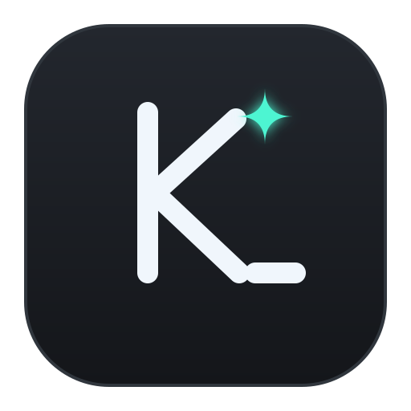

<div align="center">
  <picture>
    <source media="(prefers-color-scheme: dark)" srcset="frontend/src/shared/assets/icons/svg/kutex-app-dark.svg">
    <source media="(prefers-color-scheme: light)" srcset="frontend/src/shared/assets/icons/svg/kutex-app-light.svg">
    
  </picture>

  <h1>Kutex</h1>

  <p>
    <strong>A fast, scriptable desktop terminal emulator built with Go, Wails, and xterm.js.</strong>
  </p>

  <p>
    <a href="https://github.com/Khudo-R/kutex/actions/workflows/ci.yml"></a>
    <a href="https://github.com/Khudo-R/kutex/actions/workflows/release.yml"></a>
    
    
  </p>

  <p>
    <a href="#features">Features</a> ·
    <a href="#installation">Installation</a> ·
    <a href="#keyboard-shortcuts">Shortcuts</a> ·
    <a href="#programmatic-api">Scripting API</a> ·
    <a href="#architecture">Architecture</a> ·
    <a href="#development">Development</a>
  </p>
</div>

---

**Kutex** combines a native Go pseudo-terminal (PTY) backend with a lightweight, GPU-accelerated terminal frontend. Unlike Electron-based terminals that ship an entire Chromium instance, Kutex runs on [Wails v2](https://wails.io) using your operating system's native webview (WebKit2GTK on Linux, WebKit on macOS, WebView2 on Windows) for minimal memory overhead and instant startup.

## Features

- **Real Native PTY Session** — Spawns your login shell (`zsh`, `bash`, `fish`, etc.) inside an OS pseudo-terminal with full support for ANSI colors, job control, signals (`SIGINT`, `SIGWINCH`), and interactive TUI applications (`vim`, `nvim`, `htop`, `lazygit`, `tmux`).
- **Smart Command History Palette (`Ctrl+Shift+H`)** — Captures commands directly from the active terminal screen buffer on execution—meaning tab completions, shell history recalls (`↑`/`Ctrl+R`), and multi-line pastes are recorded accurately. Deduplicates entries and persists them across sessions.
- **Fast Folder Navigator (`Ctrl+Shift+F`)** — Browse direct or recursive subdirectories of the active working directory via `internal/system`, filter folders on the fly, and jump straight into any directory.
- **Zero-Config Nerd Fonts & Typography** — Pairs your monospace font with a bundled `Symbols Nerd Font Mono` icon fallback so prompts like Starship, Oh My Posh, and Powerlevel10k render cleanly out of the box.
- **Scriptable Automation API (`window.kutex`)** — Execute non-interactive background commands with structured output (`stdout`, `stderr`, `exitCode`, `durationMs`) or inject commands directly into the active PTY session, all synced with the terminal's live working directory.
- **Lightweight Native Binary** — Compiles into a single self-contained native executable with all frontend assets and fonts embedded at build time.

---

## Installation

### Prebuilt Binaries

Download the latest archive for your platform from the [**Releases**](https://github.com/Khudo-R/kutex/releases) page:

| Platform | Architecture | Artifact |
| :--- | :--- | :--- |
| **Linux** | `x86_64` | `kutex-linux-amd64.tar.gz` |
| **macOS** | `Universal (Apple Silicon & Intel)` | `kutex-macos-universal.zip` |
| **Windows** | `x86_64` | `kutex-windows-amd64.zip` |

### Build from Source

#### 1. Prerequisites

- **Go** `1.25+`
- **Node.js** `22+` and **pnpm** `9+`
- **Wails CLI** (`go install github.com/wailsapp/wails/v2/cmd/wails@latest`)
- **Linux system libraries** (Ubuntu / Debian):
  ```bash
  sudo apt-get update
  sudo apt-get install -y build-essential pkg-config libgtk-3-dev libwebkit2gtk-4.1-dev
  ```

#### 2. Compile

```bash
git clone https://github.com/Khudo-R/kutex.git
cd kutex
wails build
```

The compiled native binary is placed in `build/bin/kutex` (or `build/bin/kutex.app` on macOS / `build/bin/kutex.exe` on Windows).

---

## Keyboard Shortcuts

| Shortcut | Context | Action |
| :--- | :--- | :--- |
| <kbd>Ctrl</kbd> + <kbd>Shift</kbd> + <kbd>H</kbd> | Terminal | Open the searchable Command History palette |
| <kbd>Ctrl</kbd> + <kbd>Shift</kbd> + <kbd>F</kbd> | Terminal | Open the Folder Navigator for the current working directory |
| <kbd>↑</kbd> / <kbd>↓</kbd> | Palette | Navigate through filtered commands or folders |
| <kbd>Enter</kbd> | Palette | Execute selected command or `cd` into selected folder |
| <kbd>Esc</kbd> | Palette | Close the palette and return focus to the terminal |
| <kbd>Enter</kbd> | Exited Session | Restart the shell session after process exit |

---

## Programmatic API

Kutex exposes a global `window.kutex` object for automation, plugins, and developer tooling:

```ts
// 1. Run a command silently in a subshell (mirrors the PTY's current working directory)
const result = await window.kutex.executeCommand('git status --short')
console.log(result.stdout)     // " M README.md\n"
console.log(result.stderr)     // ""
console.log(result.exitCode)   // 0
console.log(result.durationMs) // 12

// 2. Send a command directly to the interactive PTY session
await window.kutex.runCommand('docker compose ps')

// 3. Query the active shell's current working directory
const cwd = await window.kutex.getCwd()

// 4. Inspect or clear persistent command history
const history = await window.kutex.getHistory()
await window.kutex.clearHistory()

// 5. Discover direct or recursive folders in a directory
const folders = await window.kutex.getFolders(cwd)
const allFolders = await window.kutex.getFoldersRecursive(cwd)
```

---

## Architecture

Kutex is split into a modular Go backend and a **Feature-Sliced Design (FSD)** Vue 3 + TypeScript frontend:

```text
kutex/
├── main.go                           # Wails entrypoint & embedded assets
├── internal/
│   ├── terminal/                     # PTY lifecycle, subshell executor & history store
│   ├── system/                       # Directory & recursive folder discovery (GetFolders, GetFoldersRecursive)
│   └── logger/                       # Structured slog handler with ANSI color output
└── frontend/src/                     # Feature-Sliced Design (FSD) frontend
    ├── app/                          # App bootstrap, global styles & window.kutex provider
    ├── pages/terminal/               # Terminal page orchestrating PTY, history & folder navigation
    ├── features/command-history/     # Screen-buffer command capture & HistoryPanel UI
    ├── features/folder-navigator/    # Directory discovery & FolderPanel UI
    ├── entities/terminal/            # XTerminal component & Wails terminal bindings
    └── shared/                       # Shared icons, Nerd Font loader, utilities & Wails bridge
```

---

## Development

Run the live development server with hot module replacement (HMR):

```bash
wails dev
```

Run the backend and frontend test suites:

```bash
# Run Go unit tests with the race detector
go test -v -race ./...

# Run frontend unit tests & coverage (Vitest)
cd frontend
pnpm run test:coverage
pnpm run lint
```

---

## License

Kutex `0.0.1` (pre-alpha) is licensed under the [Apache License, Version 2.0](LICENSE).

---

## Contributing

Contributions, bug reports, and feature requests are welcome! Feel free to open an issue or submit a pull request.

1. Fork the repository and create your branch (`git checkout -b feat/my-feature`).
2. Ensure all Go and Vitest test suites pass (`go test ./...` and `pnpm --dir frontend run test:run`).
3. Commit your changes using Conventional Commits and open a Pull Request.
