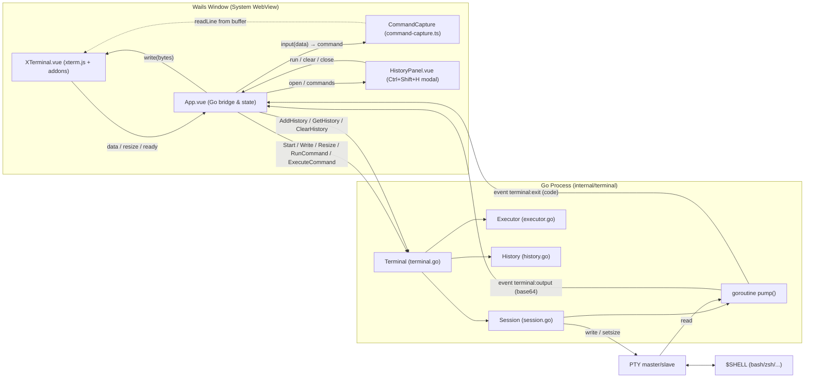
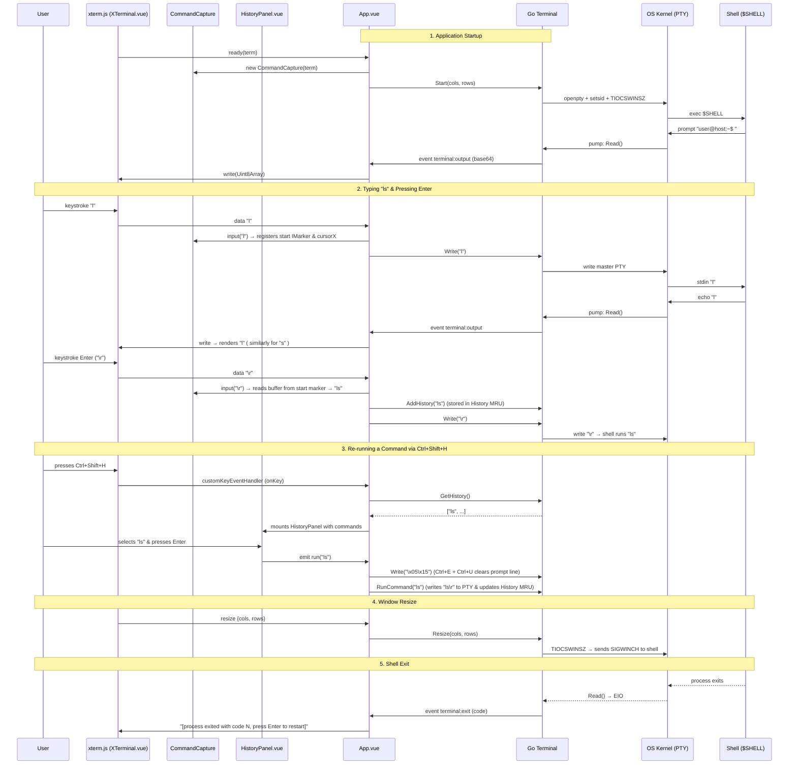

# How Kutex Works Under the Hood

**kutex** is a desktop terminal emulator built on [Wails v2](https://wails.io):
the backend is written in **Go**, the user interface is built with **Vue 3 + TypeScript**, and terminal rendering is powered by **xterm.js**. Inside the application, the user's real system shell (`$SHELL`) runs inside a pseudo-terminal (PTY), so interactive applications (`vim`, `htop`, `less`), ANSI/truecolor escape sequences, `Ctrl+C`, shell completion, and command history all work natively. On top of the shell's native capabilities, Kutex provides its own programmatic command execution API and a built-in, shell-independent command history with a searchable popup panel.

---

## 1. High-Level Architecture



Each layer has a clear, well-defined responsibility:

| Layer | Responsibility | Files |
|---|---|---|
| **Wails** | Creates the native OS window with a system WebView, serves embedded frontend assets, and provides the two-way JS ↔ Go IPC bridge | [main.go](main.go), [wails.json](wails.json) |
| **Go `Terminal`** | Modular backend package: manages the interactive PTY session, background command execution, working directory tracking, and in-memory command history | [internal/terminal/](internal/terminal/) |
| **Go `System`** | Filesystem and OS-level operations (directory listing, symlink resolution, recursive directory tree walking) | [internal/system/](internal/system/) |
| **Go `Logger`** | Modular structured logger built on Go's standard `log/slog`: ANSI color output, component tags, plain-text file logging, and a Wails logger adapter | [internal/logger/](internal/logger/) |
| **`App.vue`** | Bridges xterm.js, `CommandCapture`, `HistoryPanel.vue`, and the Go backend; invokes Go methods, subscribes to Wails events, and exposes `window.kutex` | [frontend/src/App.vue](frontend/src/App.vue) |
| **`XTerminal.vue`** | Reusable xterm.js wrapper: terminal rendering, container fitting, WebGL acceleration, and Nerd Font reloading | [frontend/src/components/XTerminal.vue](frontend/src/components/XTerminal.vue) |
| **`CommandCapture`** | Tracks where user input begins at a shell prompt using xterm markers and reads the final edited command line from the terminal buffer when `Enter` is pressed | [frontend/src/terminal/command-capture.ts](frontend/src/terminal/command-capture.ts) |
| **`HistoryPanel.vue`** | Searchable modal dialog (`Ctrl+Shift+H`) that displays recorded commands, filters them in real time, and re-runs or clears history entries | [frontend/src/components/HistoryPanel.vue](frontend/src/components/HistoryPanel.vue) |
| **Nerd Font** | Renders Powerline symbols, devicons, and file-type icons across any configured monospace font without requiring system-wide font installation | [frontend/src/fonts/nerd-font.ts](frontend/src/fonts/nerd-font.ts), [nerd-font.css](frontend/src/fonts/nerd-font.css) |

> [!IMPORTANT]
> **Dual Execution & History Model:**
> - **Interactive PTY Input:** During normal typing, the frontend does not parse or execute commands itself. Keystrokes are forwarded to the interactive shell running inside the PTY, which handles echoing, line editing, Tab completion, `Ctrl+C`, `cd`, and its own native shell history (`Up`/`Down`, `Ctrl+R`).
> - **Kutex Command History:** Independently of the shell's history file, Kutex captures every command submitted in the terminal (by reading the active terminal buffer when `Enter` is pressed) and stores it in a Go-side Most-Recently-Used (MRU) history store. Users can press **`Ctrl+Shift+H`** at any time to search past commands and re-run them.
> - **Programmatic Command API:** The Go backend also exposes `ExecuteCommand` (runs a command in the background, captures combined stdout/stderr, and tracks `cd` state), `RunCommand` (injects a command directly into the active interactive PTY and records it in history), `GetCwd` (returns the real-time working directory), `GetHistory`, and `ClearHistory`—all accessible via `window.kutex`.

---

## 2. Application Entry Point — `main.go`

[main.go](main.go) bootstraps the entire Wails application:

1. **Embedded Frontend Assets:**
   `//go:embed all:frontend/dist` embeds the compiled frontend bundle (produced by `vite build`) directly into the Go binary. As a result, the entire application is distributed as a single standalone executable.
2. **Logger Initialization:**
   Initializes a component-scoped structured logger via `log := logger.Component("main")`.
3. **Service Instantiation:**
   Creates the backend services: `term := terminal.New()` and `sys := system.New()`.
4. **Starting the Wails Runtime (`wails.Run`):**
   Configures and launches the application window with `&options.App{...}`:
   - `Title: "kutex"`, `Width: 1024`, `Height: 768` — initial window title and dimensions.
   - `AssetServer: &assetserver.Options{Assets: assets}` — serves the embedded `frontend/dist` files to the system WebView.
   - `BackgroundColour: &options.RGBA{R: 27, G: 38, B: 54, A: 1}` — matches the xterm.js background color (`#1b2636`), preventing a white flash while the WebView initializes.
   - `Logger: logger.NewWailsAdapter(nil)` — routes all internal Wails runtime logs into Kutex's structured logger under the `(wails)` component tag.
   - `OnStartup: term.Startup` — stores the Wails `context.Context` when the application starts so the backend can emit asynchronous events (`runtime.EventsEmit`) to the frontend.
   - `OnShutdown: term.Shutdown` — cleanly terminates the child shell process and closes the PTY when the application window closes.
   - `Bind: []interface{}{term, sys}` — exposes all exported methods of `Terminal` and `System` to the JavaScript frontend.

### How Wails `Bind` Works

During `wails dev`, `wails build`, or `wails generate module`, Wails inspects the structs passed to `Bind` using Go reflection and automatically generates TypeScript/JavaScript bindings:

- [frontend/wailsjs/go/terminal/Terminal.js](frontend/wailsjs/go/terminal/Terminal.js) and [Terminal.d.ts](frontend/wailsjs/go/terminal/Terminal.d.ts):
  - `Start(cols: number, rows: number): Promise<void>`
  - `Write(data: string): Promise<void>`
  - `Resize(cols: number, rows: number): Promise<void>`
  - `Stop(): Promise<void>`
  - `ExecuteCommand(command: string): Promise<string>`
  - `RunCommand(command: string): Promise<void>`
  - `GetCwd(): Promise<string>`
  - `AddHistory(command: string): Promise<void>`
  - `GetHistory(): Promise<Array<string>>`
  - `ClearHistory(): Promise<void>`
- [frontend/wailsjs/go/system/System.js](frontend/wailsjs/go/system/System.js) and [System.d.ts](frontend/wailsjs/go/system/System.d.ts):
  - `GetFolders(dirPath: string): Promise<Array<string>>`
  - `GetFoldersRecursive(root: string): Promise<Array<string>>`
- [frontend/wailsjs/runtime/](frontend/wailsjs/runtime/runtime.d.ts):
  Contains the Wails runtime event bus and window management functions (`EventsOn`, `EventsEmit`, etc.).

When the frontend calls `Start(80, 24)` in JavaScript, Wails serializes the arguments to JSON, sends them across the WebView IPC bridge to Go, and invokes `(*Terminal).Start(80, 24)`. If the Go method returns a non-nil `error`, the returned JavaScript `Promise` rejects with that error message; otherwise, it resolves with the return value.

---

## 3. Backend — `internal/terminal` Package

The terminal backend is isolated in the `internal/terminal` package and designed around the **Single Responsibility Principle (SRP)**:

```text
internal/terminal/
├── terminal.go          # Wails service facade coordinating Session, Executor, History, and Wails events
├── session.go           # Common types and callbacks for PTY sessions (OutputHandler, ExitHandler)
├── session_unix.go      # Interactive PTY session lifecycle on Unix/Linux/macOS (creack/pty)
├── session_windows.go   # Interactive PTY session lifecycle on Windows 10/11 (UserExistsError/conpty)
├── executor.go          # Background command execution engine and CWD / cd navigation tracking
├── executor_unix.go     # Unix shell command builder (-c) and live /proc/<pid>/cwd inspection
├── executor_windows.go  # Windows shell command builder (powershell.exe / cmd.exe /c) and drive root handling
├── history.go           # Thread-safe in-memory MRU command history store
├── events.go            # Wails event name constants ("terminal:output", "terminal:exit")
├── terminal_test.go     # Service-level tests for Terminal (CWD, ExecuteCommand, RunCommand, History)
├── session_test.go      # PTY session lifecycle tests (Start, Write, Resize, Stop)
├── executor_test.go     # Command execution and cd navigation tests (pwd, cd, cd -, cd ~, quotes, errors)
└── history_test.go      # Unit tests for History (ordering, deduplication, max capacity, defensive copy, clear)
```

| File | Responsibility |
|---|---|
| [terminal.go](internal/terminal/terminal.go) | Wails service facade: coordinates `Session`, `Executor`, and `History`; implements `Startup` and `Shutdown`; bridges PTY callbacks to `runtime.EventsEmit` |
| [session.go](internal/terminal/session.go) | Common session types, `errNotRunning`, and callback signatures (`OutputHandler`, `ExitHandler`) |
| [session_unix.go](internal/terminal/session_unix.go) | Interactive PTY session for Unix: spawns `$SHELL` inside a pseudo-terminal (`creack/pty`), reads output in `pump()`, handles `Write`, `Resize`, and `Stop` |
| [session_windows.go](internal/terminal/session_windows.go) | Interactive PTY session for Windows 10/11: launches PowerShell or `cmd.exe` in a native pseudo-console (`UserExistsError/conpty`), reads output in `pump()`, handles `Write`, `Resize`, and `Stop` |
| [executor.go](internal/terminal/executor.go) | Background command runner: coordinates execution, intercepts and validates `cd` commands across calls, and tracks CWD |
| [executor_unix.go](internal/terminal/executor_unix.go) | Spawns background commands via Unix `$SHELL -c` and inspects `/proc/<pid>/cwd` in real time |
| [executor_windows.go](internal/terminal/executor_windows.go) | Dispatches background commands to `cmd.exe /c` or PowerShell `-Command`, handles Windows drive paths (`cd /d`) and root directories (`C:\`) |
| [history.go](internal/terminal/history.go) | Thread-safe Most-Recently-Used (MRU) command history store holding up to 1,000 commands across shell restarts |
| [events.go](internal/terminal/events.go) | Defines the Wails event constants `EventTerminalOutput` (`"terminal:output"`) and `EventTerminalExit` (`"terminal:exit"`) |
| [terminal_test.go](internal/terminal/terminal_test.go) | Integration tests for the `Terminal` service |
| [session_test.go](internal/terminal/session_test.go) | Unit tests for the PTY `Session` lifecycle |
| [executor_test.go](internal/terminal/executor_test.go) | Unit tests for `Executor` and `cd` edge cases |
| [history_test.go](internal/terminal/history_test.go) | Unit tests for `History` (MRU deduplication, capacity eviction, defensive copying, clearing) |

---

### 3.1 `Terminal` Service (`terminal.go`)

`Terminal` is the top-level struct bound to Wails. Rather than mixing low-level PTY file descriptors, path parsing, and slice manipulation in one place, it coordinates three focused collaborators (`Session`, `Executor`, and `History`):

```go
type Terminal struct {
    ctx      context.Context
    session  *Session
    executor *Executor
    history  *History
    log      *logger.Logger
}
```

- **`New() *Terminal`**: Constructs a `Terminal` with a new `Session`, `Executor`, `History` (sized to `DefaultHistorySize = 1000`), and a logger tagged with `"terminal"`.
- **`Startup(ctx context.Context)`**: Called by Wails on app startup; stores `ctx` so `runtime.EventsEmit` can push events to the frontend.
- **`Shutdown(_ context.Context)`**: Called by Wails on app shutdown; calls `t.Stop()` to ensure the shell process is terminated cleanly.
- **`Start(cols, rows int) error`**:
  1. Queries the current working directory via `cwd := t.GetCwd()`.
  2. Constructs the `onOutput` callback, which emits `EventTerminalOutput` (`"terminal:output"`) with the Base64-encoded PTY output chunk whenever `t.ctx != nil`.
  3. Constructs the `onExit` callback, which logs the exit code and emits `EventTerminalExit` (`"terminal:exit"`).
  4. Delegates to `t.session.Start(cols, rows, cwd, onOutput, onExit)`.
- **`Write(data string) error`**: Forwards raw user input (keystrokes, control sequences, pasted text) to `t.session.Write(data)`.
- **`Resize(cols, rows int) error`**: Logs the new dimensions at `DEBUG` level and forwards them to `t.session.Resize(cols, rows)`.
- **`Stop()`**: Logs termination and calls `t.session.Stop()`.
- **`RunCommand(command string) error`**:
  1. Checks `t.session.IsRunning()`. If the interactive shell is not running, logs a warning and returns `errNotRunning` without recording the command in history.
  2. Strips any trailing `\r` or `\n` from `command` and appends a carriage return `"\r"` (simulating pressing `Enter` in the terminal).
  3. Writes the command to the PTY via `t.session.Write(cmd)`.
  4. If the write succeeds, records the original `command` in Kutex's history via `t.history.Add(command)`.
- **`AddHistory(command string)`**: Called by the frontend when the user presses `Enter` in the interactive terminal. Delegates to `t.history.Add(command)` and logs at `DEBUG` level if a non-empty command was recorded.
- **`GetHistory() []string`**: Returns a slice of recorded commands ordered from most recent to oldest (`t.history.List()`).
- **`ClearHistory()`**: Logs the action and clears all entries in `t.history.Clear()`.
- **`ExecuteCommand(command string) (string, error)`**: Executes `command` in the background via `t.executor.Execute(command, t.session.Pid())` and returns the combined stdout/stderr output.
- **`GetCwd() string`**: Returns the active working directory via `t.executor.GetCwd(t.session.Pid())`.

---

### 3.2 Interactive PTY Session — `Session` (`session.go`, `session_unix.go`, `session_windows.go`)

`Session` encapsulates the pseudo-terminal layer and child shell process. Crucially, **`Session` has zero dependency on Wails**—it communicates strictly through plain Go callbacks (`OutputHandler` and `ExitHandler`), making it straightforward to test in isolation.

The implementation is cleanly decoupled by OS build tags:
- **`session.go`**: Declares shared types (`OutputHandler`, `ExitHandler`) and the `errNotRunning` sentinel error.
- **`session_unix.go` (`//go:build !windows`)**: Implements the Unix pseudo-terminal using `github.com/creack/pty`. It manages `cmd *exec.Cmd` and `pty *os.File`, allocates `/dev/ptmx` and `/dev/pts/N`, applies `TIOCSWINSZ` window sizing ioctls, and discovers shells (`$SHELL`, `/bin/bash`, `/bin/zsh`, `/bin/sh`).
- **`session_windows.go` (`//go:build windows`)**: Implements native Windows pseudo-terminal support on Windows 10 (1809+) and Windows 11 using the Windows Pseudo Console (**ConPTY**) API via `github.com/UserExistsError/conpty`. It creates an `_HPCON` pseudo console attached to anonymous pipes, launches the shell via Win32 `CreateProcess` with `_PROC_THREAD_ATTRIBUTE_PSEUDOCONSOLE`, dynamically resizes via `ResizePseudoConsole`, and cleans up all handles on `Stop()`.

#### Default Shell Resolution on Windows
On Windows, `defaultShell()` dynamically selects the best available shell:
1. If `$SHELL` is set and resolvable (e.g., Git Bash `bash.exe`), it uses that path.
2. Next, checks for modern PowerShell 7+ (`pwsh.exe`) via `exec.LookPath`.
3. Falls back to Windows PowerShell (`powershell.exe`), available out-of-the-box on all Windows 10 and 11 systems.
4. Falls back to `%COMSPEC%` (`cmd.exe`).

#### Starting a Session: `Start(cols, rows int, dir string, onOutput OutputHandler, onExit ExitHandler) error`
1. **Clean Up Previous Session:** Calls `s.Stop()` first so any previously running shell and PTY / ConPTY are closed before starting a new one.
2. **Resolve Default Shell & Environment:** Calls `defaultShell()`, sets `TERM=xterm-256color` and `COLORTERM=truecolor` so CLI tools know 256-color and 24-bit truecolor sequences are supported, and sets the working directory `dir` if non-empty.
3. **Allocate PTY / ConPTY & Spawn Shell:**
   - On Unix: calls `pty.StartWithSize(cmd, winsize(cols, rows))`.
   - On Windows: calls `conpty.Start(shell, conpty.ConPtyDimensions(cols, rows), conpty.ConPtyWorkDir(dir), conpty.ConPtyEnv(env))`.
4. **Save State & Start Output Pump:** Stores session handles under `s.mu`, then launches the background reader goroutine `go s.pump(..., onOutput, onExit)`.

#### Reading Output: `pump()`
Reads output chunks in a 32 KB buffer (`buf := make([]byte, 32*1024)`):
- Reads from the master PTY file descriptor `f.Read(buf)` on Unix, or from `cpty.Read(buf)` on Windows.
- Base64 encodes each chunk before dispatching `onOutput` across the JSON bridge.
- Waits for process termination (`cmd.Wait()` on Unix, `cpty.Wait(ctx)` on Windows) and emits the exit code via `onExit(code)`. If `Stop()` was triggered programmatically, `s.pty` / `s.cpty` is cleared to `nil` first to suppress spurious exit events.

---

### 3.3 Background Command Execution & Directory Tracking — `Executor` (`executor.go`, `executor_unix.go`, `executor_windows.go`)

`Executor` handles programmatic background command execution (`ExecuteCommand`) and tracks the working directory across both interactive and background contexts.

```go
type Executor struct {
    mu         sync.Mutex
    currentDir string // current tracked working directory
    prevDir    string // previous working directory (supports `cd -`)
}
```

#### `GetCwd(activePid int) string`
1. **Live Inspection (`procCwd`):**
   - On Linux: reads `/proc/<pid>/cwd` via `os.Readlink` in real time when `activePid > 0`.
   - On Windows: external PID CWD inspection requires reading foreign process PEB memory, so `procCwd` cleanly falls back to the tracked `e.currentDir`.
2. **Fallback Chain:** If the interactive shell is not running, `GetCwd` returns `e.currentDir`, falling back to `os.UserHomeDir()` and finally `defaultRootDir()` (`"/"` on Unix, `C:\` / `%SystemDrive%\` on Windows).

#### `Execute(command string, activePid int) (string, error)`
1. **Empty Command Short-Circuit:** Trims whitespace; if empty, returns `"", nil`.
2. **Intercepting Pure `cd` Commands (`isPureCd` & `handleCd`):**
   - Intercepts standalone `cd` invocations in Go to preserve directory state across background calls.
   - Handles Windows drive switch flag `/d` (e.g., `cd /d D:\project`).
   - Resolves `~`, `~/path`, `~\path`, `cd -`, quotes (`"..."`, `'...'`), relative paths, and Windows drive roots (`C:\path`).
   - Validates the target directory on disk with `os.Stat` and records the change in `e.currentDir`.
3. **Cross-Platform Shell Command Execution (`buildShellCmd`):**
   - On Unix: executes via `exec.Command(shell, "-c", command)`.
   - On Windows: inspects the executable basename—uses `/c` for `cmd.exe` (`exec.Command(shell, "/c", command)`), `-NoProfile -NonInteractive -Command` for `powershell.exe` / `pwsh.exe`, and `-c` for POSIX shells.
   - Sets `cmd.Dir = cwd` and captures combined stdout/stderr.

---

### 3.4 Command History Store — `History` (`history.go`)

`History` is Kutex's own in-memory command list, completely independent of the shell's `.bash_history` or `.zsh_history`. Storing it in the Go backend ensures that history persists across shell exits/restarts and frontend hot reloads during the application's lifetime.

```go
const DefaultHistorySize = 1000

type History struct {
    mu      sync.Mutex
    max     int
    entries []string // stored oldest-first internally
}
```

#### Most-Recently-Used (MRU) Semantics & Methods
- **`NewHistory(max int) *History`**: Creates a new history store capped at `max` entries. If `max <= 0`, it defaults to `DefaultHistorySize` (`1000`).
- **`Add(command string) bool`**:
  1. Trims leading and trailing whitespace (`strings.TrimSpace(command)`). If the resulting string is empty, it returns `false` without modifying the store.
  2. Acquires `h.mu`.
  3. **Deduplication (Move-to-Front):** Scans `h.entries` for an existing entry equal to `command`. If found, removes it from its old position (`append(h.entries[:i], h.entries[i+1:]...)`).
  4. Appends `command` to the end of `h.entries` (the newest position).
  5. **Bounded Capacity Eviction:** If `len(h.entries)` exceeds `h.max` by `over`, slices off the oldest `over` elements and copies the remaining slice into a freshly allocated backing array (`append([]string(nil), h.entries[over:]...)`) so old underlying array slots can be garbage-collected.
  6. Returns `true`.
- **`List() []string`**:
  Acquires `h.mu`, allocates a new slice `out` of length `len(h.entries)`, and populates it in reverse order (`out[len(h.entries)-1-i] = e`). This guarantees:
  1. Callers receive commands ordered **most recent first**, matching what `HistoryPanel.vue` displays at the top of the list.
  2. Callers receive an isolated **defensive copy**—mutating the returned slice cannot corrupt `History`'s internal state.
- **`Clear()`**:
  Acquires `h.mu` and resets `h.entries = nil`.

---

## 4. Backend — `internal/system` Package

The [internal/system/](internal/system/) package provides high-level filesystem discovery methods and is bound to Wails (`System.js`):

```text
internal/system/
├── system.go       # GetFolders, GetFoldersRecursive, directory symlink resolution
└── system_test.go  # Unit tests for folder scanning, symlinks, and edge cases
```

### Core Functions

1. **`GetFolders(dirPath string) ([]string, error)`**:
   - Scans `dirPath` (if `dirPath == ""`, defaults to `"."`).
   - Reads directory entries via `os.ReadDir(dirPath)` (which does not follow symlinks by default).
   - Includes both regular subdirectories (`entry.IsDir()`) and **symbolic links that point to directories**: when `entry.Type()&os.ModeSymlink != 0`, it resolves the target with `os.Stat(filepath.Join(dirPath, entry.Name()))` and includes the entry if `info.IsDir()` is true (gracefully skipping broken symlinks).
2. **`GetFoldersRecursive(root string) ([]string, error)`**:
   - Performs a fast recursive walk of the directory tree under `root` (defaulting `""` to `"."`) using `filepath.WalkDir`.
   - Collects and returns the paths of all nested subdirectories (excluding `root` itself).
3. **Structured Logging:** Every scan and error is logged with contextual attributes (`path`, `root`, `count`, `error`) through `logger.Component("system")`.

---

## 5. Backend — Structured Logging System (`internal/logger`)

Kutex includes a custom structured logging package built around Go's standard `log/slog`:

```text
internal/logger/
├── handler.go      # Custom slog.Handler: ANSI colors for console, component tags, clean text for files
├── logger.go       # Logger facade, levels (DEBUG, INFO, WARN, ERROR), Config, With, Component
├── wails.go        # WailsAdapter: routes internal Wails v2 runtime logs into the structured logger
└── logger_test.go  # Unit tests for formatting, level filtering, component tags, file output, and adapter
```

### Evaluation of Go Logging Libraries

Before implementing `internal/logger`, major Go logging libraries on GitHub were evaluated:

| Library | GitHub Stars | Pros | Cons / Reason for Selection or Rejection |
|---|---|---|---|
| **uber-go/zap** | ~22k | Extremely fast, strongly typed fields | Verbose API; introduces unnecessary external dependencies for a desktop app |
| **rs/zerolog** | ~10k | Zero-allocation JSON logging | Tailored for cloud JSON ingestion; human-friendly console output is secondary |
| **sirupsen/logrus** | ~24k | Classic structured logger | In maintenance mode; slower and superseded by `log/slog` |
| **charmbracelet/log** | ~4k | Polished terminal output | Pulls in a large dependency tree (`lipgloss`, `termenv`, `mousetrap`); awkward for dual console+file formatting |
| **Standard `log/slog` (Go 1.21+)** | Go stdlib | **Zero external dependencies**, fast, official standard library API, extensible `slog.Handler` interface | **Selected.** Allows a lightweight custom `slog.Handler` with ANSI colors for the terminal, clean plain text for log files, and seamless Wails integration |

### Logger Architecture & Features

1. **Colorized Console Output (`ConsoleHandler` in `handler.go`):**
   - Formats levels with bold text (`\033[1m`), fixed width, and distinct ANSI colors for both the level tag and the log message text (`r.Message`): `[DEBUG]` (cyan `\033[36m`), `[INFO] ` (green `\033[32m`), `[WARN] ` (yellow `\033[33m`), `[ERROR]` (red `\033[31m`).
   - Colors component tags `(component)` in magenta (`\033[35m`), prints millisecond-precision timestamps (`15:04:05.000`), and dims timestamps and attribute keys (`\033[2m`).
   - Automatically disables colors when the `NO_COLOR` environment variable is set or when `TERM=dumb` (`defaultUseColor()`).
2. **First-Class Component Tagging:**
   - Calling `logger.Component("terminal")` or `logger.Component("executor")` attaches a `"component"` attribute that `ConsoleHandler` extracts and renders right after the log level as `(component)`:
     ```text
     02:46:02.626 [INFO]  (main) Starting kutex...
     00:34:22.415 [INFO]  (executor) Changed working directory from=/home/user to=/tmp/project
     00:34:22.689 [WARN]  (terminal) Attempted RunCommand while terminal session is not running command=ls
     ```
3. **Dual Output (Color Console + Clean File):**
   - While `h.out` (defaulting to `os.Stderr`) receives colorized output, `h.file` (opened in `O_CREATE|O_WRONLY|O_APPEND` mode when `Config.FilePath` is set) receives plain text completely stripped of ANSI escape sequences and prefixed with a full date-time stamp (`2006-01-02 15:04:05.000`).
   - All writes are synchronized with an internal `sync.Mutex` (`h.mu`) so concurrent goroutines never interleave log lines.
4. **Wails v2 Integration (`WailsAdapter` in `wails.go`):**
   - Implements `github.com/wailsapp/wails/v2/pkg/logger.Logger` (`Print`, `Trace`, `Debug`, `Info`, `Warning`, `Error`, `Fatal`) and tags every Wails internal message with `component="wails"`.

---

## 6. Frontend Architecture

### 6.1 Build Pipeline & Tooling

- [frontend/index.html](frontend/index.html): Mount point `<div id="app"></div>` and module script loading `src/main.ts`.
- [frontend/src/main.ts](frontend/src/main.ts): Bootstraps Vue (`createApp(App).mount('#app')`) and imports global styles from [style.css](frontend/src/style.css).
- [frontend/vite.config.ts](frontend/vite.config.ts): Configures `@vitejs/plugin-vue` and maps the `@` path alias to `src/`.
- `pnpm run build`: Runs `vue-tsc --noEmit` (strict TypeScript type checking across `.ts` and `.vue` files) followed by `vite build`, outputting production assets to `frontend/dist` for Wails to embed.
- Linting: Uses `@antfu/eslint-config` ([frontend/eslint.config.mjs](frontend/eslint.config.mjs)) enforcing 2-space indentation, single quotes, Stroustrup brace style, and no semicolons (`wailsjs/**` is ignored as auto-generated code).

---

### 6.2 `XTerminal.vue` — Reusable Terminal Component

[XTerminal.vue](frontend/src/components/XTerminal.vue) is a pure UI wrapper around `@xterm/xterm` with no direct coupling to Go or Wails.

When mounted (`onMounted`):
1. **Terminal Configuration:** Merges default `ITerminalOptions` (`cursorBlink: true`, `customGlyphs: true`, `fontFamily: DEFAULT_FONT_FAMILY`, `fontSize: 14`, `theme: { background: '#1b2636' }`) with any caller-supplied `props.options`.
2. **Nerd Font Fallback Injection:** Calls `withNerdFont()` on `options.fontFamily` so Nerd Font icons work regardless of which primary font is configured.
3. **Addons & WebGL Renderer:**
   - **FitAddon (`@xterm/addon-fit`):** Calculates the exact number of `cols` and `rows` that fit inside the container element.
   - **WebLinksAddon (`@xterm/addon-web-links`):** Detects URLs in terminal output and makes them clickable.
   - **WebglAddon (`@xterm/addon-webgl`):** Renders the terminal glyph grid on the GPU. Unlike the standard DOM renderer, the WebGL renderer with `customGlyphs: true` draws Powerline arrows, block elements, and box-drawing characters procedurally so they fill the cell seamlessly at any font size or DPI scaling. If WebGL is unavailable or loses its GPU context (`onContextLoss`), it disposes the WebGL addon and falls back cleanly to the DOM renderer.
4. **Late Font Redraw:** Starts `loadNerdFont()` at module evaluation time. Once the font promise resolves, if the terminal is still mounted, it calls `t.clearTextureAtlas()` and `t.refresh(0, t.rows - 1)` so any prompt icons that were initially rasterized into the WebGL texture atlas as missing-glyph boxes are redrawn with the loaded icon glyphs.
5. **Automatic Container Resizing:** Observes the container `div` with a `ResizeObserver` that schedules `fit()` inside `requestAnimationFrame`. Whenever `fit()` changes `cols` or `rows`, xterm triggers `t.onResize`.
6. **Events & Exposed API:**
   - Emits `data(data: string)`, `resize({ cols, rows })`, and `ready(term: Terminal)`.
   - Exposes `write`, `writeln`, `clear`, `focus`, `fit`, and the underlying `term` shallowRef via `defineExpose`.
   - Disconnects the `ResizeObserver` and disposes the xterm `Terminal` instance in `onBeforeUnmount`.

---

### 6.3 `CommandCapture` (`command-capture.ts`) — How Typed Commands Are Captured

A subtle challenge in terminal emulators is capturing the exact command a user executes when the shell itself runs inside a PTY:

- **Why naive keystroke buffering fails:** When a user types `git st<Tab><Enter>`, `onData` only sees `"git st\t\r"`. The expansion to `git status` happens inside `zsh`/`bash` in the PTY and is echoed back as terminal output. Similarly, when the user presses `Up` arrow to recall an older command, edits a word with `Ctrl+W` or arrow keys, and presses `Enter`, `onData` only sees escape sequences (`\x1b[A`, `\x17`), not the resulting command string.
- **How `CommandCapture` solves this:** Instead of guessing what the shell did from keystrokes alone, [command-capture.ts](frontend/src/terminal/command-capture.ts) records *where* on the terminal screen the user started typing their command, and reads the final rendered text directly from xterm.js's screen buffer at the moment `Enter` (`\r`) is pressed.

```ts
export class CommandCapture {
  private start?: { marker: IMarker, col: number }
  constructor(private readonly term: Terminal) {}
  // ...
}
```

#### Step-by-Step Algorithm in `input(data: string): string | undefined`

1. **Alternate Buffer Guard (`buffer.type === 'alternate'`):**
   Full-screen interactive programs (`vim`, `nvim`, `less`, `htop`, `man`) switch the terminal to the **alternate screen buffer** (`\x1b[?1049h`). While `buffer.type === 'alternate'`, `CommandCapture` calls `this.reset()` and returns `undefined`, ensuring keystrokes and `Enter` presses inside editors or pagers are never recorded as shell commands.
2. **Handling `Enter` (`data === '\r'`):**
   When the user presses `Enter`:
   - Calls `this.read()` to extract the command from the active terminal buffer.
   - Calls `this.reset()` to dispose the marker and clear `this.start` for the next prompt.
   - Returns the trimmed command string (or `undefined` if empty).
3. **Handling Interrupts (`Ctrl+C`) & Unbracketed Multi-Line Input:**
   - If `data` contains `Ctrl+C` (`\x03`), the user aborted the current command line, so `this.reset()` discards `this.start` and returns `undefined`.
   - If `data` contains `\r` inside a larger chunk that is *not* wrapped in Bracketed Paste Mode (`\x1B[200~`), multiple lines are being fed directly into the PTY before the buffer can reflect them individually, so `this.reset()` resets state cleanly.
4. **Anchoring the Start of the Command (`this.start`):**
   On the very first keystroke at a shell prompt (when `this.start` is `undefined`), `CommandCapture` records:
   ```ts
   this.start = { marker: this.term.registerMarker(0), col: buffer.cursorX }
   ```
   - `buffer.cursorX` is the exact column right after the shell prompt (e.g., after `user@host:~$ `).
   - `term.registerMarker(0)` attaches an xterm `IMarker` to the current cursor line. Unlike a static row number, an `IMarker` automatically adjusts its `.line` property as the terminal buffer scrolls up when output reaches the bottom of the screen.
5. **Reading the Command Line from the Buffer (`read()`):**
   - Verifies that `this.start` exists, `!start.marker.isDisposed`, and `start.marker.line >= 0` (has not scrolled off the scrollback buffer).
   - Reads the first line starting at column `start.col`:
     `buffer.getLine(row)?.translateToString(false, start.col) ?? ''`
     (leaving `trimRight` as `false` initially so spaces at a line wrap boundary are preserved).
   - Loops through subsequent buffer rows (`++row`) as long as `line?.isWrapped` is `true`, appending `line.translateToString(false)` to reconstruct long commands that wrapped across multiple terminal rows.
   - Finally, calls `.trim()` on the assembled string.

---

### 6.4 `HistoryPanel.vue` — Interactive Searchable Command History Modal

[HistoryPanel.vue](frontend/src/components/HistoryPanel.vue) renders the modal overlay opened by **`Ctrl+Shift+H`**.

- **Props & Events:**
  - Accepts `commands: string[]` (ordered most recent first, provided by Go's `GetHistory()`).
  - Emits `run(command: string)`, `clear()`, and `close()`.
- **Real-Time Filtering:**
  - Automatically focuses the search `<input>` on mount (`onMounted(() => filterInput.value?.focus())`).
  - `filtered` computed property performs a case-insensitive substring filter (`c.toLowerCase().includes(needle)`) over `props.commands`.
  - A `watch(filtered, ...)` watcher resets the highlighted index `selected.value = 0` whenever the search query changes.
- **Keyboard & Mouse Navigation:**
  - `ArrowDown` / `ArrowUp`: Moves the selection down or up with wrap-around arithmetic (`(selected + delta + count) % count`) and keeps the active `<li>` visible inside the scrollable list via `nextTick(() => list.value?.children[selected.value]?.scrollIntoView({ block: 'nearest' }))`.
  - `Enter`: Emits `run` with the currently highlighted command (`filtered.value[selected.value]`).
  - `Escape` or clicking the backdrop (`@mousedown.self="emit('close')"`): Emits `close`.
  - Hovering an item (`@mousemove="selected = i"`) highlights it, and clicking it (`@click="run(i)"`) immediately executes it.
  - Clicking **Clear history** (`@click="emit('clear')"`) wipes the stored history in Go and updates the panel immediately; the button is disabled when history is already empty.

---

### 6.5 `App.vue` — Bridging xterm.js, Command History, and Go

[App.vue](frontend/src/App.vue) orchestrates the terminal, command capture, history modal, and Wails backend bindings:

1. **Early Event Subscription in `setup`:**
   Subscribes to Wails events during component `setup`—*before* `XTerminal.vue` mounts and calls `Start`:
   - `terminal:output`: Decodes the Base64 payload to a `Uint8Array` (`decodeBase64`) and writes raw bytes to `terminal.value?.write(...)`. Subscribing before `Start` guarantees the very first shell prompt is never missed.
   - `terminal:exit`: Sets `exited = true` and prints `\r\n\x1B[2m[process exited with code ${code}, press Enter to restart]\x1B[0m`.
   - Unsubscribes both listeners in `onBeforeUnmount`.
2. **Terminal Ready & Shortcut Interception (`onReady` & `onKey`):**
   When `XTerminal` emits `ready(term)`:
   - Instantiates `capture = new CommandCapture(term)`.
   - Registers a custom key handler via `term.attachCustomKeyEventHandler(onKey)`. When the user presses **`Ctrl+Shift+H`** (`e.ctrlKey && e.shiftKey && !e.altKey && !e.metaKey && e.code === 'KeyH'`), `onKey` intercepts the `keydown` event, calls `e.preventDefault()`, opens the history modal (`openHistory()`), and returns `false` so xterm.js does not send control characters to the PTY.
   - Calls `startShell(term.cols, term.rows)` so the shell starts with the exact initial grid dimensions.
3. **Handling User Input (`onData`):**
   - While the shell is running (`!exited`):
     1. Passes `data` to `capture?.input(data)` *before* sending `data` to the PTY (so on `Enter`, the buffer is read while the cursor and command line are still at the prompt).
     2. If `capture.input(data)` returns a non-empty `command`, calls `AddHistory(command)` asynchronously to persist it in Go's `History` store.
     3. Calls `Write(data)` to forward the keystroke(s) to the PTY.
   - When the shell has exited (`exited === true`):
     Ignores all input except `Enter` (`\r`), which clears the screen (`terminal.value?.clear()`) and restarts the shell (`startShell`).
4. **Re-Running a Command from the History Panel (`runFromHistory`):**
   When the user selects a command in `HistoryPanel.vue`:
   - Closes the modal and returns focus to the terminal (`closeHistory()`).
   - Calls `capture?.reset()` so any partially tracked prompt state is cleared.
   - Sends `CLEAR_LINE = '\x05\x15'` (`Ctrl+E` to move the cursor to the end of the current line, followed by `Ctrl+U` to kill the line backward to the prompt in `bash`/`zsh`) via `await Write(CLEAR_LINE)`. This ensures that if the user had half-typed something at the prompt before pressing `Ctrl+Shift+H`, the half-typed text is erased rather than prepended to the selected history command.
   - Calls `await RunCommand(command)`, which injects `command + "\r"` into the PTY and moves `command` to the top of the MRU history in Go.
5. **Global Programmatic API (`window.kutex`):**
   For automation or interactive debugging in DevTools (`F12`), `App.vue` exposes:
   ```ts
   window.kutex = {
     executeCommand: ExecuteCommand, // runs a command in the background and returns Promise<string>
     runCommand: RunCommand,         // injects a command into the active PTY and records it in history
     getCwd: GetCwd,                 // returns Promise<string> with the current working directory
     getHistory: GetHistory,         // returns Promise<string[]> with MRU history (newest first)
     clearHistory: ClearHistory,     // clears all recorded history entries
   }
   ```
   Example usage from the browser console:
   ```js
   await window.kutex.executeCommand('ls -la')
   await window.kutex.executeCommand('cd ..')
   await window.kutex.runCommand('htop')
   await window.kutex.getHistory()
   ```

---

### 6.6 Nerd Font Support (`nerd-font.ts` & `nerd-font.css`)

[nerd-font.ts](frontend/src/fonts/nerd-font.ts) and [nerd-font.css](frontend/src/fonts/nerd-font.css) provide out-of-the-box icon rendering:

- **Bundled Symbols-Only Font:** The app bundles `Symbols Nerd Font Mono` ([SymbolsNerdFontMono-Regular.woff2](frontend/src/assets/fonts/SymbolsNerdFontMono-Regular.woff2)), which contains **only** Nerd Font icon glyphs (Private Use Area code points for Powerline arrows, git branch symbols, devicons, file icons) and no regular ASCII/Latin letters. Using the *Mono* variant ensures every icon is strictly 1 character cell wide, which CLI tools like `starship`, `eza --icons`, `lsd`, and `neovim` expect.
- **Smart Fallback Insertion (`withNerdFont`):** Inserts `"Symbols Nerd Font Mono"` into the CSS `font-family` list immediately *before* the first generic family keyword (`monospace`, `ui-monospace`, `sans-serif`, `serif`, `system-ui`). If it were placed *after* `monospace`, the browser would resolve unknown glyphs against the OS default monospace font and never reach the Nerd Font fallback. For example:
  `'Menlo, Consolas, "DejaVu Sans Mono", "Liberation Mono", monospace'`
  becomes:
  `'Menlo, Consolas, "DejaVu Sans Mono", "Liberation Mono", "Symbols Nerd Font Mono", monospace'`.
  Regular text is drawn with the user's primary font, while Private Use Area code points fall through to `Symbols Nerd Font Mono` automatically.
- **Eager Preloading (`loadNerdFont`):** Browsers normally lazy-load `@font-face` web fonts only when a DOM element tries to render a character from that font's Unicode range. Because xterm.js renders onto a `<canvas>` / WebGL surface, lazy loading would cause the first prompt's Powerline icons to be drawn as missing-glyph boxes (`□`). `loadNerdFont()` forces an immediate fetch via `document.fonts.load('16px "Symbols Nerd Font Mono"', '\uE0B0')` (using the Powerline arrow `\uE0B0` as a sample glyph), caches the resulting `Promise`, and never rejects. Combined with `font-display: block` in CSS and `clearTextureAtlas()` in `XTerminal.vue`, icons render crisply as soon as the font loads.

---

## 7. Complete Lifecycle: From Keystroke to Screen & Command History



Notice that during interactive typing, characters do not appear on screen immediately when a key is pressed; they appear only after the shell (or foreground program) echoes them back through the PTY. This is why password prompts (`sudo`, `ssh`) automatically hide typed characters when the child process disables terminal `ECHO` in `termios`.

---

## 8. Build, Development & Testing

| Command | Description |
|---|---|
| `wails dev` / `wails dev -tags webkit2_41` | Starts the Vite dev server (`pnpm run dev`) with hot module replacement (HMR), compiles the Go backend, regenerates `frontend/wailsjs/`, and opens the native desktop window. Browser debugging is also available at `http://localhost:34115` |
| `wails build` / `wails build -tags webkit2_41` | Runs `pnpm install` → `pnpm run build` → embeds `frontend/dist` into the compiled Go binary at `build/bin/kutex`. The `-tags webkit2_41` build flag is required on modern Linux distributions (e.g., Fedora 42, Ubuntu 24.04+, Arch Linux) that ship `webkit2gtk-4.1` instead of `4.0` |
| `wails generate module` | Regenerates TypeScript/JavaScript bindings in `frontend/wailsjs/` from the bound Go structs without starting the UI |
| `pnpm lint` / `pnpm lint:fix` | Runs ESLint inside `frontend/` |
| `pnpm build` | Runs `vue-tsc --noEmit && vite build` inside `frontend/` |
| `go test -v ./...` | Runs all Go unit and integration tests ([internal/terminal/](internal/terminal/), [internal/system/](internal/system/), [internal/logger/](internal/logger/)) |

The [build/](build/README.md) directory contains platform packaging assets for Wails: application icons, macOS `Info.plist`, and Windows manifest/icon/NSIS installer templates.

---

## 9. Design Notes, Limitations & Potential Improvements

1. **Up-to-Date Wails Bindings (Resolved):** The template `app.go` and its generated `App.js` / `App.d.ts` bindings have been removed. `Terminal.js` and `Terminal.d.ts` expose the full set of terminal and history methods (`Start`, `Write`, `Resize`, `Stop`, `ExecuteCommand`, `RunCommand`, `GetCwd`, `AddHistory`, `GetHistory`, `ClearHistory`), and `System.js` exposes `GetFolders` and `GetFoldersRecursive`.
2. **Direct Lifecycle Hook Wiring (Resolved):** In `main.go`, `options.App` passes `OnStartup: term.Startup` and `OnShutdown: term.Shutdown` directly without redundant wrapper closures.
3. **Command History Characteristics & Heuristics:**
   - **In-Memory Lifecycle:** `History` ([internal/terminal/history.go](internal/terminal/history.go)) stores up to 1,000 commands in Go memory (`DefaultHistorySize`). It survives shell exits/restarts and frontend reloads, and is cleared when the application closes. Persisting history across application restarts can be added directly inside `History` by loading/saving a file in `os.UserConfigDir()`.
   - **Screen-Buffer Capture Heuristics:** Because `CommandCapture` ([frontend/src/terminal/command-capture.ts](frontend/src/terminal/command-capture.ts)) reads the edited line off the xterm screen buffer on `Enter`, it accurately reflects Tab completions and `Up`/`Down` shell history edits. However, as a screen-scraping heuristic:
     - If a prompt theme renders a right-aligned prompt (`RPROMPT` in `zsh`) on the same row as the command and does not clear it before `Enter`, the right-side text on that line may be included.
     - If the user types ahead while a foreground command is still printing output, the start marker may anchor before the next prompt appears.
     - Lines typed into interactive REPLs running in the normal buffer (such as `python` or `node`) are also captured when `Enter` is pressed; full-screen TUI apps using the alternate buffer (`vim`, `less`, `htop`) are automatically excluded.
   - **Clearing the Line Before Re-Run:** When running a command from `HistoryPanel.vue`, `App.vue` sends `\x05\x15` (`Ctrl+E` + `Ctrl+U`) to clear any half-typed input at the prompt. This relies on standard Emacs-mode readline/zle bindings (the default in `bash` and `zsh`) and may not clear the line if the user has configured `bindkey -v` (vi normal mode) in their shell.
4. **Windows Platform Support (Resolved):** Native Windows 10/11 support is fully implemented using the Windows Pseudo Console (**ConPTY**) API (`github.com/UserExistsError/conpty`). The backend is cleanly modularized via build tags (`session_unix.go` vs `session_windows.go`, and `executor_unix.go` vs `executor_windows.go`). Windows interactive sessions default to modern PowerShell 7+ (`pwsh.exe`) or Windows PowerShell (`powershell.exe`) with fallback to `%COMSPEC%` (`cmd.exe`), and background execution handles `cmd.exe /c`, PowerShell `-Command`, `cd /d` drive switches, and Windows drive roots (`C:\`).
5. **Unused Frontend Dependency:** `vue-router` is listed in `frontend/package.json` but is not currently used by the single-window terminal UI.
6. **Output Batching & Backpressure:** Each `Read` of up to 32 KB in `pump()` emits an individual Wails event (`terminal:output`) with ~33% Base64 overhead. Under extreme output throughput (e.g., `cat` on a multi-gigabyte file or `yes`), the WebView event queue can lag behind the PTY reader. Coalescing output over a ~4–16 ms window and/or pausing `pump()` until xterm's `term.write(data, callback)` acknowledges processing would provide end-to-end backpressure.
7. **Concurrent `Start` Calls:** Calling `Session.Start` concurrently from multiple goroutines could race between `s.Stop()` and `pty.StartWithSize`. The UI only calls `Start` sequentially (`onReady` and `Enter` after exit), but holding a lifecycle mutex across the entire `Start` method would harden it against concurrent callers.
8. **Single Session Architecture:** Kutex currently manages one active `Session`. Supporting multiple tabs or split panes would involve indexing sessions by ID (`map[string]*Session`) and scoping Wails events or payloads with a session identifier.
