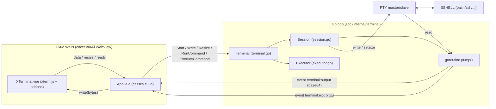
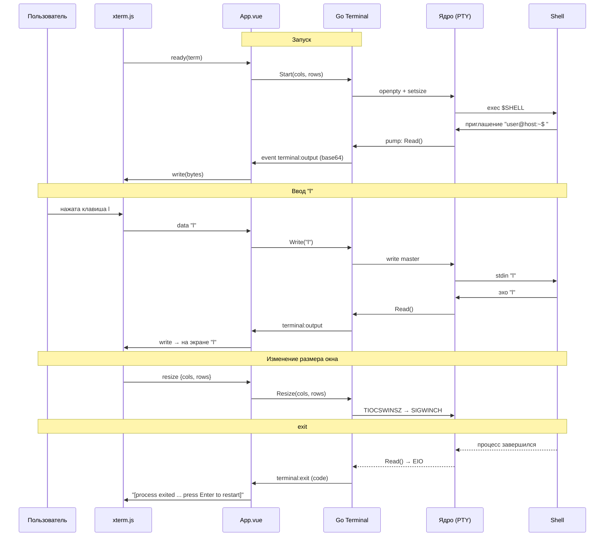

# Как устроен kutex изнутри

**kutex** — десктопный эмулятор терминала. Он построен на [Wails v2](https://wails.io):
бэкенд написан на **Go**, интерфейс — на **Vue 3 + TypeScript**, а отрисовку терминала
выполняет **xterm.js**. Внутри приложения запускается настоящий shell пользователя
(`$SHELL`) в псевдотерминале (PTY), поэтому работают `vim`, `htop`, цвета, Ctrl+C,
история команд и т.д.

---

## 1. Общая архитектура



Каждая часть делает своё:

| Слой | Чем занимается | Файлы |
|---|---|---|
| Wails | Создаёт нативное окно с WebView, раздаёт фронтенд, обеспечивает связь JS ↔ Go | [main.go](main.go), [wails.json](wails.json) |
| Go `Terminal` | Модульный пакет: интерактивная PTY-сессия, выполнение команд, CWD | [internal/terminal/](internal/terminal/) |
| `App.vue` | Связывает xterm и Go: вызывает методы Go и подписывается на события | [frontend/src/App.vue](frontend/src/App.vue) |
| `XTerminal.vue` | Обёртка над xterm.js: рендеринг, подгонка размера, WebGL, шрифты | [frontend/src/components/XTerminal.vue](frontend/src/components/XTerminal.vue) |
| Nerd Font | Показывает иконки (Powerline, devicons) при любом шрифте | [frontend/src/fonts/nerd-font.ts](frontend/src/fonts/nerd-font.ts), [nerd-font.css](frontend/src/fonts/nerd-font.css) |

> Важно: **терминал поддерживает как интерактивный ввод, так и программный вызов команд**:
> - При обычном вводе с клавиатуры фронтенд не интерпретирует команды сам: эхо,
>   редактирование строки, история, автодополнение и `cd` обрабатывает интерактивный shell в PTY.
> - Дополнительно Go-бэкенд предоставляет методы `ExecuteCommand` (фоновый запуск команд с захватом вывода и поддержкой `cd`), `RunCommand` (отправка команды прямо в активный PTY) и `GetCwd` (получение текущей рабочей директории).

---

## 2. Точка входа — `main.go`

[main.go](main.go):

1. `//go:embed all:frontend/dist` встраивает собранный фронтенд (результат `vite build`)
   прямо в бинарник. Поэтому приложение поставляется одним исполняемым файлом.
2. Создаётся `term := terminal.New()`.
3. Вызывается `wails.Run(...)` с такими опциями:
   - окно `1024×768` с заголовком `kutex`;
   - `AssetServer` раздаёт встроенные файлы в WebView;
   - `BackgroundColour` `rgb(27,38,54)` совпадает с фоном терминала (`#1b2636`),
     поэтому при запуске не мелькает белое окно;
   - `OnStartup: term.Startup` сохраняет Wails-контекст для отправки событий (`runtime.EventsEmit`);
   - `OnShutdown: term.Shutdown` убивает shell при закрытии окна;
   - `Bind: []interface{}{term}` делает методы `Terminal` доступными из JS.

### Как работает `Bind`

При `wails dev` или `wails build` Wails с помощью рефлексии находит экспортируемые
методы структуры `Terminal` из пакета `terminal` и генерирует JS-обёртки:

- [frontend/wailsjs/go/terminal/Terminal.js](frontend/wailsjs/go/terminal/Terminal.js) и `.d.ts`:
  функции `Start(cols, rows)`, `Write(data)`, `Resize(cols, rows)`, `Stop()`,
  `ExecuteCommand(command)`, `RunCommand(command)`, `GetCwd()`.
  Каждая возвращает `Promise`.
- [frontend/wailsjs/runtime/](frontend/wailsjs/runtime/runtime.d.ts) содержит runtime API
  (`EventsOn`, `EventsEmit` и др.).

Вызов `Start(80, 24)` в JS сериализуется в JSON, через IPC WebView попадает в Go
и вызывает `(*Terminal).Start(80, 24)`. Если Go-метод вернул `error`, Promise
в JS отклоняется (reject).

---

## 3. Бэкенд — пакет `internal/terminal`

Бэкенд вынесен в изолированный пакет `internal/terminal` и разделен по принципу единственной ответственности (Single Responsibility):

| Файл | Ответственность |
|---|---|
| [terminal.go](internal/terminal/terminal.go) | Сервис Wails: координирует `Session` и `Executor`, реализует `Startup`, `Shutdown` и связку с `runtime.EventsEmit` |
| [session.go](internal/terminal/session.go) | Интерактивная сессия: запуск `$SHELL` в PTY (`creack/pty`), чтение вывода (`pump`), передача ввода, `Resize`, `Stop` |
| [executor.go](internal/terminal/executor.go) | Фоновое выполнение: запуск команд через `$SHELL -c`, перехват и валидация `cd`, определение CWD через `/proc` |
| [events.go](internal/terminal/events.go) | Константы событий Wails (`terminal:output`, `terminal:exit`) |
| [executor_test.go](internal/terminal/executor_test.go) | Тесты движка выполнения (`pwd`, `cd`, `cd -`, `cd ~`, кавычки, ошибки) |
| [session_test.go](internal/terminal/session_test.go) | Тесты жизненного цикла PTY (`Start`, `Write`, `Resize`, `Stop`) |
| [terminal_test.go](internal/terminal/terminal_test.go) | Тесты сервиса `Terminal` |

### Состояние сервиса

```go
type Terminal struct {
    ctx      context.Context
    session  *Session
    executor *Executor
}
```

Сервис `Terminal` делегирует работу двум специализированным компонентам: `Session` отвечает за интерактивный PTY, а `Executor` — за фоновые команды и навигацию по директориям.

### `Start(cols, rows)`

### Архитектура пакета

Бэкенд разделен по принципу единственной ответственности (Single Responsibility):

```text
internal/terminal/
├── terminal.go       # Фасад/сервис Wails (связка Session, Executor и событий Wails)
├── session.go        # Интерактивная PTY-сессия (creack/pty, pump, write, resize, stop)
├── executor.go       # Движок фонового выполнения команд и CWD/cd-навигация
├── events.go         # Константы событий Wails ("terminal:output", "terminal:exit")
├── executor_test.go  # Тесты выполнения команд и навигации cd
├── session_test.go   # Тесты PTY и жизненного цикла сессии
└── terminal_test.go  # Тесты фасада Terminal
```

### 1. Сервис `Terminal` (`terminal.go`)

`Terminal` — это Wails-сервис, методы которого биндятся в JS. Он не содержит низкоуровневой логики PTY или парсинга путей, а координирует `Session` и `Executor`:

```go
type Terminal struct {
    ctx      context.Context
    session  *Session
    executor *Executor
}
```

- `Startup(ctx)`: запоминает контекст Wails для вызова `runtime.EventsEmit`.
- `Shutdown(ctx)`: корректно останавливает интерактивную сессию (`t.Stop()`).
- `Start(cols, rows)`: запрашивает актуальный CWD через `t.GetCwd()`, передает колбэки `onOutput` и `onExit` (в которых вызывает `runtime.EventsEmit`) и запускает интерактивный shell в `session.Start(...)`.
- `Write(data)`: проксирует ввод в `session.Write(data)`.
- `Resize(cols, rows)`: проксирует изменение размера в `session.Resize(cols, rows)`.
- `Stop()`: вызывает `session.Stop()`.
- `RunCommand(command)`: проверяет активность сессии и отправляет `command + "\r"` в `session.Write`.
- `ExecuteCommand(command)`: передает вызов в `executor.Execute(command, session.Pid())`.
- `GetCwd()`: передает вызов в `executor.GetCwd(session.Pid())`.

---

### 2. Интерактивная PTY-сессия — `Session` (`session.go`)

`Session` инкапсулирует работу с псевдотерминалом (`creack/pty`) и дочерним процессом. Компонент **полностью изолирован от Wails** и общается через Go-колбэки (`OutputHandler`, `ExitHandler`), поэтому легко тестируется в unit-тестах без создания Wails-окружения.

```go
type Session struct {
    mu  sync.Mutex
    cmd *exec.Cmd  // процесс shell
    pty *os.File   // master-дескриптор PTY
}
```

#### Запуск `Start(cols, rows, dir, onOutput, onExit)`:
1. Останавливает предыдущую сессию, если она есть (`s.Stop()`).
2. Определяет шелл по умолчанию через `defaultShell()`: `$SHELL` → `/bin/bash` → `/bin/zsh` → `/bin/sh` → `sh`.
3. Добавляет в окружение `TERM=xterm-256color` и `COLORTERM=truecolor`.
4. Устанавливает рабочую директорию процесса `cmd.Dir = dir`.
5. `pty.StartWithSize` (библиотека `creack/pty`) создает пару PTY, подключает slave к процессу (stdin/stdout/stderr), переводит процесс в новую сессию (`setsid`), задает геометрию окна (`winsize`) и возвращает master-дескриптор `f`.
6. Запускает фоновую горутину `go s.pump(cmd, f, onOutput, onExit)`.

#### `Write(data)`:
Записывает байты строки в master PTY. Если сессия не запущена, возвращает `errNotRunning`.

#### `Resize(cols, rows)`:
Вызывает `pty.Setsize(f, winsize(cols, rows))`. Ядро посылает сигналу `SIGWINCH` активному процессу (например, `vim` или `htop`), и он перерисовывается.

#### `Stop()`:
Под мьютексом обнуляет указатели `cmd` и `pty`, завершает процесс (`cmd.Process.Kill()`) и закрывает master PTY (`f.Close()`). Закрытие дескриптора посылает `SIGHUP` дочерним процессам.

#### `pump(cmd, f, onOutput, onExit)` — чтение вывода PTY:
```text
loop:
    n, err := f.Read(buf[32KB])
    если n > 0 и f всё ещё текущий дескриптор → onOutput(base64(buf[:n]))
    если err → выход   (EIO на Linux после выхода процесса, или "file closed" после Stop)
cmd.Wait()
если f всё ещё текущий дескриптор → обнулить s.cmd/s.pty, закрыть f, onExit(exitCode)
```

- **Почему base64:** события Wails сериализуются в JSON-строки. Если блок в 32 КБ разорвет многобайтовый символ UTF-8, JSON повредит байты. Base64 передает сырые байты, а xterm.js сам склеивает поток.
- **Проверка `s.currentPty() == f`:** защищает от смешивания вывода старой и новой сессии при быстром перезапуске.
- **`onExit` вызывается только при естественном завершении** (пользователь набрал `exit` или нажал Ctrl+D).

---

### 3. Фоновое выполнение команд — `Executor` (`executor.go`)

`Executor` отвечает за программный запуск команд и поддержание состояния рабочей директории.

```go
type Executor struct {
    mu         sync.Mutex
    currentDir string // текущая директория
    prevDir    string // предыдущая директория (для `cd -`)
}
```

#### `GetCwd(activePid int) string`:
1. Если интерактивный shell запущен (`activePid > 0`), на Linux читается символическая ссылка `/proc/<pid>/cwd` через `os.Readlink`. Это дает **настоящую директорию shell в реальном времени**, даже если пользователь менял папки прямо в окне терминала.
2. Если шелл не запущен или чтение `/proc` недоступно, возвращается `currentDir`, либо домашняя папка пользователя `os.UserHomeDir()`, либо `"/"`.

#### `Execute(command string, activePid int) (string, error)`:
1. **Перехват `cd`**:
   - Поскольку `cd` — встроенная инструкция shell, запуск `sh -c "cd dir"` завершился бы без изменения директории для следующих команд.
   - Если команда — чистый `cd` (без `|`, `&`, `;`, redirection):
     - `cd` или `cd ~` → переход в домашнюю папку `os.UserHomeDir()`;
     - `cd -` → возврат в `prevDir`;
     - `cd path` или `cd ~/subpath` → разрешение относительного или абсолютного пути;
     - поддерживаются кавычки: `cd "My Documents"`.
     - проверяется существование и тип (`os.Stat` + `info.IsDir()`).
     - сохраняются `prevDir` и `currentDir`.
     - возвращается `""`, `nil`.
2. **Остальные команды (`ls`, `git`, цепочки `cd /tmp && ls`)**:
   - Запускается `exec.Command(defaultShell(), "-c", command)` в директории `cwd = e.GetCwd(activePid)`.
   - `cmd.CombinedOutput()` захватывает stdout и stderr в единую строку.

#### Вспомогательные функции (`session.go`):
- `defaultShell()`: находит системный shell пользователя (`$SHELL` → `/bin/bash` → `/bin/zsh` → `/bin/sh` → `sh`).
- `winsize(cols, rows)`: подставляет 80×24, если передан некорректный размер (≤ 0), и формирует структуру `pty.Winsize` с полями `uint16`.

---

## 4. Фронтенд

### Сборка и запуск

- [frontend/index.html](frontend/index.html) содержит `<div id="app">` и подключает `src/main.ts`.
- [frontend/src/main.ts](frontend/src/main.ts): `createApp(App).mount('#app')` и глобальные стили [style.css](frontend/src/style.css).
- [vite.config.ts](frontend/vite.config.ts): плагин Vue и алиас `@` → `src/`.
- `pnpm run build` = `vue-tsc --noEmit` (проверка типов) + `vite build` → `frontend/dist`.
  Wails встраивает эту папку в бинарник.
- Линтер — `@antfu/eslint-config` ([eslint.config.mjs](frontend/eslint.config.mjs)),
  стиль: 2 пробела, одинарные кавычки, без `;`. Папка `wailsjs/` игнорируется.

### `XTerminal.vue` — переиспользуемый компонент терминала

[XTerminal.vue](frontend/src/components/XTerminal.vue) ничего не знает о Go.
Это обёртка над xterm.js.

При монтировании (`onMounted`):

1. Собирает опции: мигающий курсор, `customGlyphs: true`, размер 14, фон `#1b2636`.
   Их можно переопределить через prop `options`.
2. Добавляет к `fontFamily` резервный шрифт Nerd Font через `withNerdFont()` (см. ниже).
3. Создаёт `Terminal` и подключает аддоны:
   - **FitAddon** подбирает `cols × rows` под размер контейнера;
   - **WebLinksAddon** делает URL в выводе кликабельными;
   - **WebglAddon** рисует терминал через GPU. В отличие от DOM-рендерера, он сам
     рисует символы Powerline и псевдографику (`customGlyphs`), поэтому они ровно
     заполняют ячейку. Если WebGL недоступен или контекст потерян, xterm возвращается
     к DOM-рендереру.
4. Когда шрифт Nerd Font загрузится, сбрасывает атлас глифов (`clearTextureAtlas`)
   и перерисовывает экран. Так иконки, которые успели нарисоваться квадратиками,
   отображаются правильно.
5. `ResizeObserver` следит за контейнером и при изменении размера вызывает `fit()`
   через `requestAnimationFrame`. Если `cols` или `rows` изменились, xterm генерирует
   `onResize`.
6. Пробрасывает события наружу:
   - `data` — ввод пользователя (клавиши, вставка), уже в виде терминальных последовательностей;
   - `resize` — новый размер в символах;
   - `ready` — терминал готов, передаётся экземпляр `Terminal`.
7. Через `defineExpose` открывает методы `write`, `writeln`, `clear`, `focus`, `fit` и `term`.

При размонтировании отключает observer и освобождает ресурсы (`dispose`).

### `App.vue` — связка xterm и Go

[App.vue](frontend/src/App.vue):

- **Подписка на события делается в `setup`**, то есть *до* монтирования `XTerminal`
  и, значит, до запуска shell. Иначе первые байты (приглашение shell) могли бы
  прийти раньше подписки и потеряться.
  - `terminal:output` → `decodeBase64` → `Uint8Array` → `terminal.write(bytes)`.
  - `terminal:exit` → `exited = true` и серым текстом выводится
    `[process exited with code N, press Enter to restart]`.
- `onReady(term)` вызывает `Start(term.cols, term.rows)`, и shell сразу
  запускается с правильным размером.
- `onData(data)`:
  - если shell работает, вызывает `Write(data)`;
  - если shell завершился, всё игнорирует, кроме Enter (`\r`). По Enter очищает
    экран и запускает shell заново.
- `onResize` вызывает `Resize(cols, rows)`.
- Если `Start` завершился ошибкой, выводит её красным текстом и ставит `exited = true`.
  Тогда Enter запускает ещё одну попытку.
- **Глобальный объект `window.kutex`**: для удобного вызова команд из фронтенда или прямо из консоли DevTools (`F12`), `App.vue` регистрирует:
  ```ts
  window.kutex = {
    executeCommand: ExecuteCommand, // выполняет команду и возвращает Promise<string> с выводом
    runCommand: RunCommand,         // отправляет команду в активный интерактивный PTY
    getCwd: GetCwd,                 // возвращает текущую директорию
  }
  ```
  Пример использования в консоли браузера:
  ```js
  await window.kutex.executeCommand('ls -la')
  await window.kutex.executeCommand('cd ..')
  await window.kutex.runCommand('htop')
  ```

### Поддержка Nerd Font

[nerd-font.ts](frontend/src/fonts/nerd-font.ts) и [nerd-font.css](frontend/src/fonts/nerd-font.css):

- В приложение встроен шрифт `Symbols Nerd Font Mono`
  ([woff2](frontend/src/assets/fonts/SymbolsNerdFontMono-Regular.woff2)). В нём
  **только иконки**, букв нет. Вариант *Mono* гарантирует, что каждая иконка занимает
  ровно одну ячейку, как ожидают starship, eza и neovim.
- `withNerdFont(fontFamily)` вставляет этот шрифт в список `font-family` перед первым
  общим семейством (`monospace` и т.п.). Без этого браузер мог бы так и не дойти до него
  в цепочке резервных шрифтов. Например:
  `'Menlo, Consolas, "DejaVu Sans Mono", "Liberation Mono", monospace'` →
  `'..., "Liberation Mono", "Symbols Nerd Font Mono", monospace'`.
  Обычный текст рисуется основным шрифтом, а символы из Private Use Area берутся из
  Nerd Font. Пользователю ничего не нужно устанавливать.
- `loadNerdFont()` принудительно загружает шрифт через `document.fonts.load(...)`
  с примером глифа `\uE0B0` (стрелка Powerline). Обычно браузер загружает веб-шрифт
  только когда он впервые понадобился. Promise кешируется и никогда не отклоняется.
  `font-display: block` в CSS убирает «прыжок» с подменой шрифта.

---

## 5. Полный цикл: от нажатия клавиши до символа на экране



Обратите внимание: символ появляется на экране не сразу при нажатии, а только после
того, как shell вернёт **эхо**. Именно так работают настоящие терминалы.

---

## 6. Сборка и разработка

| Команда | Что делает |
|---|---|
| `wails dev` / `wails dev -tags webkit2_41` | Запускает Vite dev-сервер (`pnpm run dev`) с hot reload, собирает Go и открывает окно. Также регенерирует `frontend/wailsjs/`. Отладка из браузера доступна на `http://localhost:34115` |
| `wails build` / `wails build -tags webkit2_41` | `pnpm install` → `pnpm run build` → `frontend/dist` встраивается в Go-бинарник → `build/bin/kutex`. Флаг `-tags webkit2_41` нужен в современных дистрибутивах Linux (Fedora 42, Ubuntu 24+), где установлен пакет `webkit2gtk-4.1`, а не устаревший 4.0 |
| `pnpm lint` / `pnpm lint:fix` | ESLint (из `frontend/`) |
| `go test -v ./...` | Запуск тестов бэкенда ([internal/terminal/](internal/terminal/)) на выполнение `ls`, `pwd`, `cd`, `cd -`, `cd ~`, PTY сессию и обработку ошибок |

Папка [build/](build/README.md) — ресурсы Wails для упаковки: иконка приложения,
`Info.plist` для macOS, манифест, `icon.ico` и NSIS-инсталлятор для Windows.

---

## 7. Замечания и потенциальные проблемы

Найдено при анализе текущего состояния репозитория:

1. **Устаревшие сгенерированные файлы (исправлено).** Шаблонный `app.go` удалён из git (`git rm app.go`), неиспользуемый байндинг убран из `main.go`, а сгенерированные файлы `App.js` и `App.d.ts` удалены. Вместо них `Terminal.js` и `Terminal.d.ts` содержат актуальные методы `ExecuteCommand`, `RunCommand`, `GetCwd`.
2. **Windows не поддерживается**, хотя в `build/windows` лежат ресурсы для этой платформы.
   `creack/pty` на Windows возвращает `ErrUnsupported`, а `defaultShell()` ищет Unix-пути.
   Для Windows нужен ConPTY (например, через `github.com/UserExistsError/conpty`)
   и shell по умолчанию `powershell.exe` или `cmd.exe`.
3. **Неиспользуемая зависимость** `vue-router` в `package.json`.
4. **Нет батчинга и backpressure.** Каждый блок до 32 КБ отправляется отдельным
   JSON-событием, и размер вырастает примерно на 33% из-за base64. При очень большом
   выводе (`cat` огромного файла, `yes`) WebView может не успевать за потоком.
   Улучшить можно так: склеивать вывод за ~5–16 мс и/или приостанавливать чтение,
   пока xterm не обработает данные (callback у `term.write`).
5. **Конкурентные `Start`.** Если два вызова `Start` выполнятся одновременно, второй
   перезапишет `cmd`/`pty` первого, и первый процесс останется висеть. Сейчас UI
   так не делает, но можно держать мьютекс на весь `Start`.
6. **Одна сессия.** Вкладок и сплитов нет. Чтобы их добавить, нужен реестр сессий
   по ID (`map[string]*session`) и ID в событиях (`terminal:output:<id>`).
7. **Прямая передача хуков жизненного цикла (реализовано).** В `options.App` хуки `OnStartup` и `OnShutdown` сразу указывают на `term.Startup` и `term.Shutdown` без лишних анонимных обёрток.
